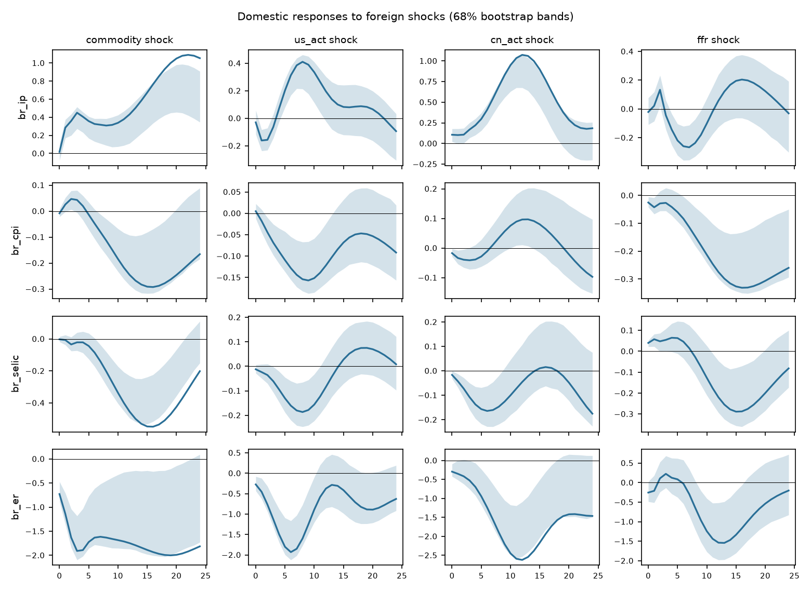

# Block-exogenous SVAR

Foreign block {commodity, us_act, cn_act, ffr}, domestic block {br_ip, br_cpi, br_selic, br_er}. Sample 1999-11 to 2019-12 (242 observations), p = 4, recursive identification in the order listed, 1000 bootstrap draws, 68% percentile bands.

| Test | Statistic | df | p |
|---|---|---|---|
| block exogeneity LR (Sims) | 83.12 | 64 | 0.054 |
| lag-augmented Wald (p=4, d_max=0) | 88.62 | 64 | 0.023 |
| portmanteau (h=12) | 879.77 | 512 | <0.001 |
| max companion root | 0.980 |  |  |

**Warning:** the block-exogeneity restriction is rejected at 5% (LR p = 0.054, lag-augmented Wald p = 0.023). It is still imposed. With integrated data the levels LR test over-rejects; the lag-augmented Wald is the valid test (see the exogeneity screen).

## Forecast error variance decomposition

**br_ip**

| h | commodity | us_act | cn_act | ffr | br_ip | br_cpi | br_selic | br_er |
|---|---|---|---|---|---|---|---|---|
| 0 | 0.0 | 0.0 | 0.5 | 0.0 | 99.4 | 0.0 | 0.0 | 0.0 |
| 6 | 15.5 | 3.8 | 6.9 | 3.0 | 64.6 | 0.7 | 4.6 | 0.8 |
| 12 | 12.4 | 7.1 | 39.5 | 2.6 | 27.6 | 0.3 | 9.2 | 1.2 |
| 24 | 40.9 | 3.4 | 33.7 | 2.0 | 12.9 | 0.6 | 5.5 | 1.0 |

**br_cpi**

| h | commodity | us_act | cn_act | ffr | br_ip | br_cpi | br_selic | br_er |
|---|---|---|---|---|---|---|---|---|
| 0 | 0.1 | 0.1 | 0.6 | 1.4 | 0.6 | 97.2 | 0.0 | 0.0 |
| 6 | 1.0 | 5.5 | 0.9 | 2.0 | 2.6 | 56.1 | 4.8 | 27.1 |
| 12 | 8.5 | 7.6 | 1.5 | 11.8 | 6.5 | 27.8 | 2.6 | 33.8 |
| 24 | 16.1 | 3.8 | 1.5 | 23.3 | 5.7 | 11.0 | 4.4 | 34.2 |

**br_selic**

| h | commodity | us_act | cn_act | ffr | br_ip | br_cpi | br_selic | br_er |
|---|---|---|---|---|---|---|---|---|
| 0 | 0.0 | 0.3 | 0.5 | 3.0 | 0.1 | 0.4 | 95.8 | 0.0 |
| 6 | 0.6 | 3.1 | 4.8 | 1.1 | 4.6 | 3.5 | 78.2 | 4.2 |
| 12 | 14.9 | 4.9 | 4.1 | 2.9 | 12.8 | 2.2 | 49.1 | 9.1 |
| 24 | 35.5 | 2.8 | 2.9 | 8.5 | 9.5 | 2.1 | 31.9 | 6.7 |

**br_er**

| h | commodity | us_act | cn_act | ffr | br_ip | br_cpi | br_selic | br_er |
|---|---|---|---|---|---|---|---|---|
| 0 | 6.1 | 0.9 | 1.0 | 0.7 | 0.0 | 0.4 | 0.1 | 90.8 |
| 6 | 20.4 | 13.4 | 4.2 | 0.2 | 0.2 | 1.2 | 0.8 | 59.6 |
| 12 | 18.7 | 11.0 | 18.6 | 4.1 | 0.3 | 2.1 | 1.5 | 43.7 |
| 24 | 24.1 | 8.0 | 22.3 | 5.6 | 0.2 | 3.4 | 2.1 | 34.4 |

Share of domestic forecast error variance due to foreign shocks at the last horizon: br_ip 80.0%, br_cpi 44.7%, br_selic 49.7%, br_er 59.9%.

## Parameter stability

| Test | Break | LR | df | chi2 p | bootstrap p (199) |
|---|---|---|---|---|---|
| Chow LR at the chosen date, domestic block | 2009-01 | 491.7 | 196 | <0.001 | 0.010 |
| sup-LR (Andrews 1993), domestic block | 2004-03 | 758.8 | 196 |  | 0.005 |

Bootstrap p-values come from the constant-coefficient fit, so they test the null of no break at any date in the trimmed range (sup-LR) or at the chosen date (Chow).
