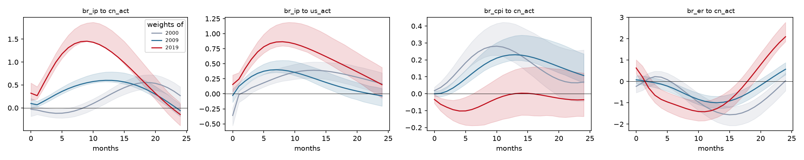
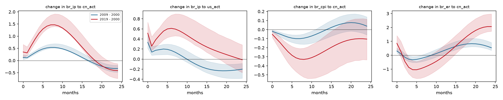
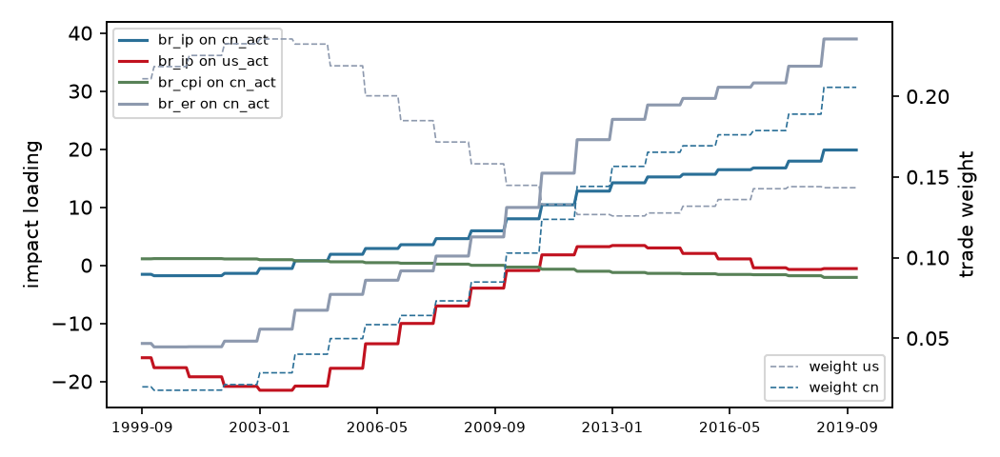

# Trade-weighted block-exogenous SVAR (M1)

Variant **interacted**, sample 1999-09 to 2019-12 (244 observations), p = 2. Weights are 3-year moving averages of each partner's share of exports plus imports, lagged 1 year(s). Impulse responses hold the weights at the values of each frozen year; 1000 bootstrap draws with the observed weight path, 68% Hall bands; differences are formed draw by draw.

## Frozen weights

| Year | us | cn |
|---|---|---|
| 2000 | 0.218 | 0.018 |
| 2009 | 0.158 | 0.085 |
| 2019 | 0.143 | 0.206 |

## Is the time variation real?

| Test | Statistic | df | chi2 p | bootstrap p |
|---|---|---|---|---|
| LR: weights do not change transmission | 59.07 | 24 | <0.001 | 0.015 |
| LR: GVAR star loading is enough | 71.79 | 36 | <0.001 | 0.100 |
| LR: weight levels do not enter | 31.22 | 8 | <0.001 |  |
| equal partner slopes Wald | 44.74 | 12 | <0.001 |  |

Bootstrap p-values regenerate the data from the restricted model along the observed weight path and re-estimate both models on every draw, so they do not rely on the chi-square limit, which can over-reject with persistent regressors.

## Headline responses by frozen year

| Response | h | 2000 | 2009 | 2019 | 2009 minus 2000 | 2019 minus 2000 |
|---|---|---|---|---|---|---|
| br_ip to cn_act | 0 | -0.029 [-0.185, +0.119] | +0.096 [+0.002, +0.208] | +0.321 [+0.163, +0.543] | +0.125 [+0.036, +0.236] * | +0.350 [+0.100, +0.659] * |
| br_ip to cn_act | 3 | -0.105 [-0.200, -0.019] | +0.215 [+0.156, +0.283] | +0.769 [+0.645, +0.933] | +0.320 [+0.261, +0.400] * | +0.874 [+0.705, +1.093] * |
| br_ip to cn_act | 6 | -0.098 [-0.211, -0.009] | +0.420 [+0.370, +0.524] | +1.312 [+1.234, +1.584] | +0.519 [+0.472, +0.643] * | +1.411 [+1.289, +1.756] * |
| br_ip to cn_act | 12 | +0.238 [+0.094, +0.343] | +0.601 [+0.572, +0.782] | +1.307 [+1.319, +1.775] | +0.363 [+0.348, +0.550] * | +1.069 [+1.039, +1.606] * |
| br_ip to cn_act | 24 | +0.268 [+0.117, +0.458] | -0.059 [-0.187, +0.085] | -0.144 [-0.386, +0.107] | -0.327 [-0.481, -0.194] * | -0.412 [-0.738, -0.131] * |
| br_ip to us_act | 0 | -0.360 [-0.529, -0.231] | -0.028 [-0.143, +0.080] | +0.155 [+0.028, +0.311] | +0.332 [+0.211, +0.483] * | +0.514 [+0.346, +0.734] * |
| br_ip to us_act | 3 | +0.099 [+0.011, +0.214] | +0.287 [+0.223, +0.367] | +0.573 [+0.465, +0.703] | +0.188 [+0.086, +0.274] * | +0.474 [+0.306, +0.628] * |
| br_ip to us_act | 6 | +0.225 [+0.153, +0.366] | +0.395 [+0.348, +0.531] | +0.835 [+0.744, +1.083] | +0.170 [+0.079, +0.290] * | +0.610 [+0.451, +0.874] * |
| br_ip to us_act | 12 | +0.388 [+0.259, +0.524] | +0.295 [+0.232, +0.474] | +0.758 [+0.693, +1.135] | -0.094 [-0.155, +0.069] | +0.370 [+0.276, +0.762] * |
| br_ip to us_act | 24 | +0.166 [+0.006, +0.348] | -0.034 [-0.204, +0.089] | +0.153 [-0.070, +0.438] | -0.200 [-0.381, -0.086] * | -0.013 [-0.269, +0.283] |
| br_cpi to cn_act | 0 | +0.018 [-0.005, +0.039] | -0.001 [-0.016, +0.013] | -0.034 [-0.058, -0.005] | -0.019 [-0.031, -0.003] * | -0.052 [-0.087, -0.009] * |
| br_cpi to cn_act | 3 | +0.102 [+0.066, +0.159] | +0.034 [+0.008, +0.068] | -0.094 [-0.159, -0.039] | -0.068 [-0.104, -0.042] * | -0.197 [-0.301, -0.127] * |
| br_cpi to cn_act | 6 | +0.218 [+0.170, +0.306] | +0.118 [+0.084, +0.177] | -0.094 [-0.189, -0.004] | -0.100 [-0.153, -0.060] * | -0.312 [-0.464, -0.202] * |
| br_cpi to cn_act | 12 | +0.264 [+0.201, +0.419] | +0.229 [+0.194, +0.333] | -0.005 [-0.143, +0.127] | -0.035 [-0.123, +0.027] | -0.269 [-0.520, -0.117] * |
| br_cpi to cn_act | 24 | +0.069 [-0.045, +0.258] | +0.107 [+0.064, +0.235] | -0.036 [-0.134, +0.122] | +0.038 [-0.058, +0.140] | -0.105 [-0.334, +0.115] |
| br_er to cn_act | 0 | -0.230 [-0.528, +0.039] | +0.076 [-0.101, +0.271] | +0.628 [+0.347, +1.011] | +0.306 [+0.152, +0.505] * | +0.858 [+0.426, +1.414] * |
| br_er to cn_act | 3 | +0.225 [-0.133, +0.477] | -0.060 [-0.283, +0.151] | -0.647 [-0.994, -0.144] | -0.286 [-0.451, -0.037] * | -0.872 [-1.333, -0.187] * |
| br_er to cn_act | 6 | -0.094 [-0.419, +0.237] | -0.333 [-0.575, -0.089] | -1.063 [-1.534, -0.628] | -0.239 [-0.479, -0.021] * | -0.969 [-1.656, -0.380] * |
| br_er to cn_act | 12 | -1.321 [-1.758, -0.919] | -0.981 [-1.239, -0.686] | -1.374 [-1.774, -0.874] | +0.340 [+0.094, +0.654] * | -0.053 [-0.663, +0.705] |
| br_er to cn_act | 24 | +0.029 [-0.441, +0.392] | +0.568 [+0.312, +0.879] | +2.092 [+1.864, +2.766] | +0.539 [+0.350, +0.913] * | +2.063 [+1.721, +2.971] * |

`*` marks a difference whose band excludes zero.

