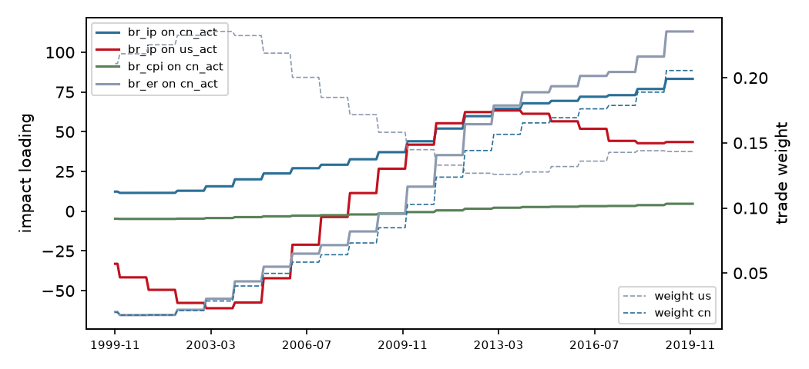

# Trade-weighted block-exogenous SVAR (M1)

Variant **interacted**, sample 1999-11 to 2019-12 (242 observations), p = 4. Weights are 3-year moving averages of each partner's share of exports plus imports, lagged 1 year(s). Impulse responses hold the weights at the values of each frozen year; 1000 bootstrap draws with the observed weight path, 68% Hall bands; differences are formed draw by draw.

## Frozen weights

| Year | us | cn |
|---|---|---|
| 2000 | 0.218 | 0.018 |
| 2009 | 0.158 | 0.085 |
| 2019 | 0.143 | 0.206 |

## Is the time variation real?

| Test | Statistic | df | chi2 p | bootstrap p |
|---|---|---|---|---|
| LR: weights do not change transmission | 91.82 | 40 | <0.001 | 0.005 |
| LR: GVAR star loading is enough | 104.54 | 60 | <0.001 | 0.070 |
| LR: weight levels do not enter | 25.39 | 8 | 0.001 |  |
| equal partner slopes Wald | 52.09 | 20 | <0.001 |  |

Bootstrap p-values regenerate the data from the restricted model along the observed weight path and re-estimate both models on every draw, so they do not rely on the chi-square limit, which can over-reject with persistent regressors.

## Headline responses by frozen year

| Response | h | 2000 | 2009 | 2019 | 2009 minus 2000 | 2019 minus 2000 |
|---|---|---|---|---|---|---|
| br_ip to cn_act | 0 | +0.051 [-0.102, +0.182] | +0.162 [+0.078, +0.257] | +0.364 [+0.227, +0.550] | +0.112 [+0.033, +0.213] * | +0.313 [+0.092, +0.597] * |
| br_ip to cn_act | 3 | -0.064 [-0.225, +0.068] | +0.038 [-0.074, +0.110] | +0.175 [-0.050, +0.321] | +0.102 [-0.013, +0.195] | +0.239 [-0.063, +0.475] |
| br_ip to cn_act | 6 | -0.299 [-0.538, -0.186] | +0.376 [+0.287, +0.530] | +1.310 [+1.261, +1.745] | +0.674 [+0.644, +0.897] * | +1.609 [+1.539, +2.196] * |
| br_ip to cn_act | 12 | +0.452 [+0.241, +0.661] | +0.753 [+0.712, +1.081] | +1.374 [+1.409, +2.147] | +0.300 [+0.278, +0.604] * | +0.922 [+0.871, +1.756] * |
| br_ip to cn_act | 24 | +0.244 [+0.022, +0.662] | +0.156 [+0.031, +0.473] | +0.884 [+0.781, +1.560] | -0.089 [-0.371, +0.164] | +0.640 [+0.301, +1.342] * |
| br_ip to us_act | 0 | -0.165 [-0.288, -0.055] | +0.130 [+0.056, +0.221] | +0.223 [+0.139, +0.337] | +0.295 [+0.202, +0.430] * | +0.388 [+0.269, +0.561] * |
| br_ip to us_act | 3 | -0.148 [-0.283, -0.041] | +0.114 [+0.051, +0.212] | +0.157 [+0.084, +0.278] | +0.262 [+0.178, +0.407] * | +0.305 [+0.202, +0.491] * |
| br_ip to us_act | 6 | +0.424 [+0.352, +0.623] | +0.455 [+0.406, +0.618] | +0.644 [+0.553, +0.855] | +0.032 [-0.107, +0.149] | +0.221 [+0.013, +0.408] * |
| br_ip to us_act | 12 | +0.367 [+0.294, +0.618] | +0.085 [-0.027, +0.291] | +0.162 [-0.038, +0.510] | -0.282 [-0.486, -0.171] * | -0.205 [-0.498, +0.061] |
| br_ip to us_act | 24 | +0.027 [-0.127, +0.353] | -0.318 [-0.481, -0.162] | -0.247 [-0.405, +0.061] | -0.345 [-0.660, -0.221] * | -0.274 [-0.605, +0.011] |
| br_cpi to cn_act | 0 | -0.021 [-0.045, -0.001] | -0.006 [-0.021, +0.008] | +0.021 [-0.000, +0.047] | +0.015 [+0.003, +0.030] * | +0.042 [+0.008, +0.083] * |
| br_cpi to cn_act | 3 | +0.011 [-0.049, +0.081] | +0.011 [-0.027, +0.058] | +0.026 [-0.043, +0.108] | +0.000 [-0.042, +0.044] | +0.015 [-0.101, +0.137] |
| br_cpi to cn_act | 6 | +0.223 [+0.145, +0.350] | +0.124 [+0.077, +0.206] | -0.068 [-0.178, +0.048] | -0.099 [-0.173, -0.043] * | -0.291 [-0.492, -0.124] * |
| br_cpi to cn_act | 12 | +0.653 [+0.570, +0.971] | +0.408 [+0.359, +0.615] | -0.330 [-0.563, -0.161] | -0.245 [-0.398, -0.165] * | -0.982 [-1.449, -0.807] * |
| br_cpi to cn_act | 24 | +0.190 [-0.043, +0.481] | +0.199 [+0.095, +0.415] | +0.110 [-0.125, +0.433] | +0.009 [-0.130, +0.197] | -0.080 [-0.489, +0.347] |
| br_er to cn_act | 0 | -0.283 [-0.580, -0.054] | -0.005 [-0.188, +0.164] | +0.496 [+0.222, +0.843] | +0.278 [+0.124, +0.475] * | +0.779 [+0.346, +1.329] * |
| br_er to cn_act | 3 | +0.277 [-0.286, +0.800] | +0.334 [-0.017, +0.709] | +0.364 [-0.156, +1.031] | +0.058 [-0.255, +0.424] | +0.087 [-0.748, +1.038] |
| br_er to cn_act | 6 | +0.374 [-0.320, +1.026] | +0.037 [-0.397, +0.494] | -1.343 [-2.116, -0.593] | -0.337 [-0.753, +0.156] | -1.717 [-2.931, -0.513] * |
| br_er to cn_act | 12 | -1.821 [-3.116, -1.342] | -1.307 [-2.136, -1.058] | -2.348 [-3.799, -1.866] | +0.514 [+0.075, +1.179] * | -0.527 [-1.974, +0.720] |
| br_er to cn_act | 24 | +0.009 [-1.227, +0.414] | +0.035 [-0.714, +0.326] | +1.834 [+1.351, +3.042] | +0.026 [-0.312, +0.695] | +1.826 [+1.405, +3.783] * |

`*` marks a difference whose band excludes zero.

