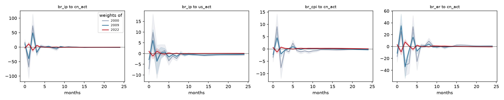
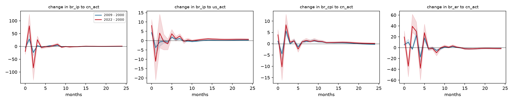
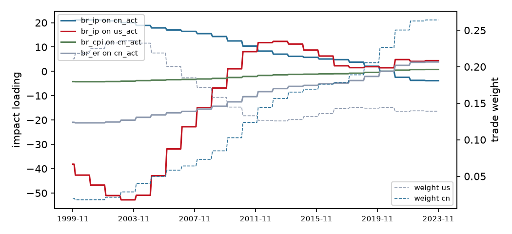

# Trade-weighted block-exogenous SVAR (M1)

Variant **interacted**, sample 1999-11 to 2023-11 (289 observations), p = 4. Weights are 3-year moving averages of each partner's share of exports plus imports, lagged 1 year(s). Impulse responses hold the weights at the values of each frozen year; 1000 bootstrap draws with the observed weight path, 68% Hall bands; differences are formed draw by draw.

## Frozen weights

| Year | us | cn |
|---|---|---|
| 2000 | 0.218 | 0.018 |
| 2009 | 0.158 | 0.085 |
| 2022 | 0.140 | 0.263 |

## Is the time variation real?

| Test | Statistic | df | chi2 p | bootstrap p |
|---|---|---|---|---|
| LR: weights do not change transmission | 78.51 | 40 | <0.001 | 0.005 |
| LR: GVAR star loading is enough | 112.59 | 60 | <0.001 | 0.005 |
| LR: weight levels do not enter | 48.24 | 8 | <0.001 |  |
| equal partner slopes Wald | 58.26 | 20 | <0.001 |  |

Bootstrap p-values regenerate the data from the restricted model along the observed weight path and re-estimate both models on every draw, so they do not rely on the chi-square limit, which can over-reject with persistent regressors.

## Headline responses by frozen year

| Response | h | 2000 | 2009 | 2022 | 2009 minus 2000 | 2022 minus 2000 |
|---|---|---|---|---|---|---|
| br_ip to cn_act | 0 | +16.595 [+12.168, +26.107] | +11.254 [+8.259, +17.702] | -2.909 [-4.582, -2.098] | -5.341 [-8.410, -3.908] * | -19.504 [-30.709, -14.272] * |
| br_ip to cn_act | 3 | -20.255 [-31.773, -13.292] | -17.531 [-27.428, -11.759] | +5.764 [+4.016, +9.040] | +2.723 [+1.272, +4.653] * | +26.019 [+17.589, +40.661] * |
| br_ip to cn_act | 6 | +0.128 [-3.582, +3.337] | +2.668 [+0.013, +5.396] | -0.711 [-1.415, +0.014] | +2.541 [+1.327, +4.504] * | -0.839 [-4.632, +3.587] |
| br_ip to cn_act | 12 | +0.778 [-0.052, +1.606] | -0.511 [-1.074, -0.124] | -0.423 [-0.781, -0.247] | -1.289 [-2.124, -0.700] * | -1.201 [-2.290, -0.299] * |
| br_ip to cn_act | 24 | -1.122 [-1.873, -0.875] | -0.900 [-1.542, -0.804] | -0.204 [-0.502, -0.094] | +0.222 [+0.005, +0.371] * | +0.918 [+0.582, +1.546] * |
| br_ip to us_act | 0 | -7.126 [-9.956, -5.595] | -2.850 [-4.434, -1.908] | +0.952 [+0.686, +1.425] | +4.277 [+3.591, +5.685] * | +8.079 [+6.334, +11.344] * |
| br_ip to us_act | 3 | +0.520 [-2.685, +4.179] | +0.199 [-2.112, +2.942] | +0.033 [-0.783, +0.728] | -0.321 [-1.345, +0.656] | -0.487 [-4.907, +3.421] |
| br_ip to us_act | 6 | -1.203 [-2.346, -0.073] | -0.507 [-1.301, +0.280] | -0.110 [-0.341, +0.181] | +0.695 [+0.131, +1.211] * | +1.093 [-0.192, +2.405] |
| br_ip to us_act | 12 | -0.524 [-0.878, -0.222] | -0.583 [-0.859, -0.394] | +0.012 [-0.175, +0.201] | -0.060 [-0.293, +0.143] | +0.536 [+0.159, +0.984] * |
| br_ip to us_act | 24 | -0.578 [-1.002, -0.494] | -0.313 [-0.641, -0.233] | +0.065 [-0.086, +0.247] | +0.265 [+0.198, +0.418] * | +0.644 [+0.545, +1.116] * |
| br_cpi to cn_act | 0 | -3.346 [-5.261, -2.453] | -2.269 [-3.568, -1.663] | +0.585 [+0.421, +0.926] | +1.076 [+0.790, +1.694] * | +3.931 [+2.884, +6.187] * |
| br_cpi to cn_act | 3 | -0.387 [-0.964, +0.014] | -0.460 [-0.804, -0.219] | +0.267 [+0.145, +0.431] | -0.072 [-0.325, +0.259] | +0.655 [+0.177, +1.358] * |
| br_cpi to cn_act | 6 | -0.645 [-1.224, -0.111] | +0.198 [+0.035, +0.455] | +0.197 [+0.063, +0.323] | +0.843 [+0.453, +1.385] * | +0.842 [+0.187, +1.503] * |
| br_cpi to cn_act | 12 | -0.228 [-0.558, -0.144] | +0.189 [+0.078, +0.332] | +0.253 [+0.133, +0.413] | +0.417 [+0.321, +0.764] * | +0.480 [+0.341, +0.890] * |
| br_cpi to cn_act | 24 | -0.053 [-0.315, +0.085] | -0.307 [-0.550, -0.189] | +0.044 [-0.067, +0.238] | -0.254 [-0.452, -0.057] * | +0.097 [-0.054, +0.450] |
| br_er to cn_act | 0 | -16.619 [-26.190, -12.123] | -11.264 [-17.785, -8.224] | +2.935 [+2.090, +4.555] | +5.355 [+3.895, +8.425] * | +19.553 [+14.223, +30.766] * |
| br_er to cn_act | 3 | -28.741 [-45.683, -21.311] | -6.485 [-10.916, -4.112] | +0.929 [+0.136, +1.787] | +22.256 [+16.573, +35.104] * | +29.671 [+21.646, +47.078] * |
| br_er to cn_act | 6 | +2.349 [-0.545, +4.762] | -0.392 [-2.279, +1.422] | -0.044 [-0.889, +0.556] | -2.742 [-4.623, -0.428] * | -2.393 [-5.300, +0.735] |
| br_er to cn_act | 12 | -2.336 [-4.366, -1.331] | -0.471 [-1.160, +0.111] | +0.789 [+0.389, +1.573] | +1.865 [+1.165, +3.381] * | +3.125 [+1.985, +5.545] * |
| br_er to cn_act | 24 | +1.155 [+0.619, +2.317] | -0.147 [-0.611, +0.293] | -0.435 [-1.005, +0.181] | -1.302 [-2.352, -0.886] * | -1.590 [-2.970, -0.799] * |

`*` marks a difference whose band excludes zero.

