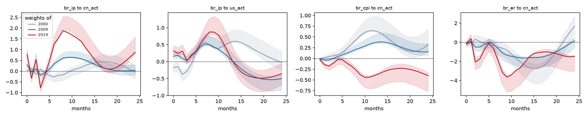
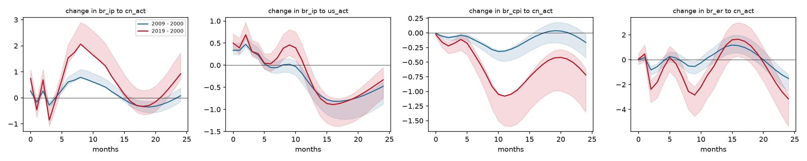
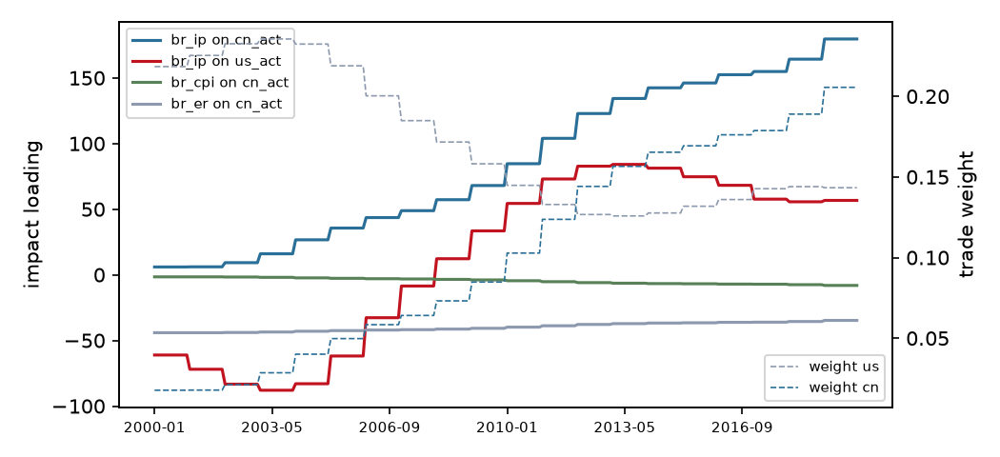

# Trade-weighted block-exogenous SVAR (M1)

Variant **interacted**, sample 2000-01 to 2019-12 (240 observations), p = 6. Weights are 3-year moving averages of each partner's share of exports plus imports, lagged 1 year(s). Impulse responses hold the weights at the values of each frozen year; 1000 bootstrap draws with the observed weight path, 68% Hall bands; differences are formed draw by draw.

## Frozen weights

| Year | us | cn |
|---|---|---|
| 2000 | 0.218 | 0.018 |
| 2009 | 0.158 | 0.085 |
| 2019 | 0.143 | 0.206 |

## Is the time variation real?

| Test | Statistic | df | chi2 p | bootstrap p |
|---|---|---|---|---|
| LR: weights do not change transmission | 101.79 | 56 | <0.001 | 0.020 |
| LR: GVAR star loading is enough | 126.81 | 84 | 0.002 | 0.130 |
| LR: weight levels do not enter | 22.36 | 8 | 0.004 |  |
| equal partner slopes Wald | 55.38 | 28 | 0.002 |  |

Bootstrap p-values regenerate the data from the restricted model along the observed weight path and re-estimate both models on every draw, so they do not rely on the chi-square limit, which can over-reject with persistent regressors.

## Headline responses by frozen year

| Response | h | 2000 | 2009 | 2019 | 2009 minus 2000 | 2019 minus 2000 |
|---|---|---|---|---|---|---|
| br_ip to cn_act | 0 | +0.025 [-0.134, +0.157] | +0.293 [+0.222, +0.397] | +0.775 [+0.673, +1.012] | +0.268 [+0.201, +0.387] * | +0.749 [+0.564, +1.084] * |
| br_ip to cn_act | 3 | +0.081 [-0.111, +0.213] | -0.200 [-0.321, -0.099] | -0.776 [-0.968, -0.534] | -0.280 [-0.366, -0.144] * | -0.857 [-1.096, -0.492] * |
| br_ip to cn_act | 6 | -0.275 [-0.516, -0.146] | +0.334 [+0.215, +0.472] | +1.255 [+1.122, +1.613] | +0.609 [+0.531, +0.808] * | +1.530 [+1.337, +2.043] * |
| br_ip to cn_act | 12 | +0.170 [-0.079, +0.335] | +0.580 [+0.527, +0.869] | +1.390 [+1.432, +2.137] | +0.410 [+0.401, +0.721] * | +1.220 [+1.225, +2.073] * |
| br_ip to cn_act | 24 | -0.047 [-0.368, +0.259] | +0.032 [-0.166, +0.299] | +0.875 [+0.773, +1.592] | +0.079 [-0.144, +0.380] | +0.922 [+0.717, +1.725] * |
| br_ip to us_act | 0 | -0.180 [-0.316, -0.067] | +0.157 [+0.076, +0.259] | +0.318 [+0.231, +0.468] | +0.338 [+0.253, +0.481] * | +0.499 [+0.393, +0.706] * |
| br_ip to us_act | 3 | -0.284 [-0.467, -0.184] | +0.026 [-0.061, +0.149] | +0.026 [-0.073, +0.208] | +0.310 [+0.238, +0.492] * | +0.310 [+0.207, +0.565] * |
| br_ip to us_act | 6 | +0.494 [+0.380, +0.707] | +0.440 [+0.377, +0.630] | +0.527 [+0.443, +0.769] | -0.054 [-0.165, +0.091] | +0.032 [-0.138, +0.263] |
| br_ip to us_act | 12 | +0.532 [+0.504, +0.850] | +0.154 [+0.058, +0.402] | +0.301 [+0.145, +0.776] | -0.378 [-0.605, -0.279] * | -0.232 [-0.547, +0.077] |
| br_ip to us_act | 24 | -0.025 [-0.255, +0.312] | -0.503 [-0.847, -0.391] | -0.356 [-0.691, -0.058] | -0.478 [-0.885, -0.384] * | -0.332 [-0.740, -0.054] * |
| br_cpi to cn_act | 0 | -0.005 [-0.029, +0.015] | -0.015 [-0.032, -0.003] | -0.033 [-0.063, -0.011] | -0.010 [-0.025, +0.002] | -0.028 [-0.069, +0.006] |
| br_cpi to cn_act | 3 | +0.066 [+0.016, +0.144] | +0.000 [-0.043, +0.035] | -0.109 [-0.218, -0.067] | -0.066 [-0.124, -0.042] * | -0.175 [-0.335, -0.107] * |
| br_cpi to cn_act | 6 | +0.232 [+0.180, +0.366] | +0.121 [+0.082, +0.196] | -0.108 [-0.234, -0.037] | -0.112 [-0.188, -0.077] * | -0.341 [-0.566, -0.252] * |
| br_cpi to cn_act | 12 | +0.646 [+0.627, +0.979] | +0.366 [+0.332, +0.545] | -0.403 [-0.695, -0.368] | -0.280 [-0.467, -0.256] * | -1.049 [-1.597, -1.064] * |
| br_cpi to cn_act | 24 | +0.319 [+0.172, +0.684] | +0.155 [+0.075, +0.347] | -0.400 [-0.778, -0.331] | -0.164 [-0.425, -0.028] * | -0.719 [-1.354, -0.615] * |
| br_er to cn_act | 0 | -0.171 [-0.421, +0.048] | -0.156 [-0.324, -0.021] | -0.130 [-0.406, +0.116] | +0.014 [-0.136, +0.167] | +0.040 [-0.382, +0.467] |
| br_er to cn_act | 3 | +0.068 [-0.483, +0.626] | -0.493 [-0.942, -0.192] | -1.740 [-2.665, -1.355] | -0.561 [-0.999, -0.313] * | -1.808 [-3.064, -1.161] * |
| br_er to cn_act | 6 | -0.319 [-1.077, +0.270] | -0.178 [-0.716, +0.196] | -0.644 [-1.642, -0.151] | +0.141 [-0.283, +0.572] | -0.325 [-1.515, +0.624] |
| br_er to cn_act | 12 | -2.070 [-3.261, -1.489] | -1.646 [-2.593, -1.473] | -2.653 [-4.434, -2.560] | +0.424 [-0.249, +0.983] | -0.583 [-2.366, +0.158] |
| br_er to cn_act | 24 | +1.669 [+0.897, +2.714] | +0.161 [-0.598, +0.512] | -1.477 [-3.049, -1.393] | -1.507 [-2.530, -1.186] * | -3.146 [-5.359, -2.759] * |

`*` marks a difference whose band excludes zero.

