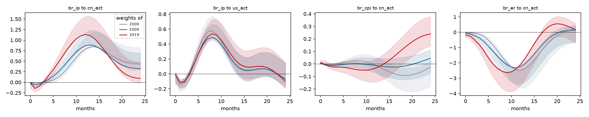
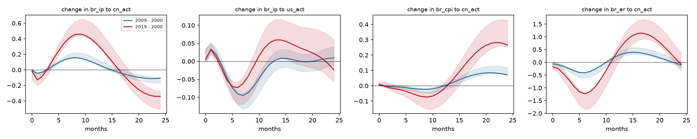
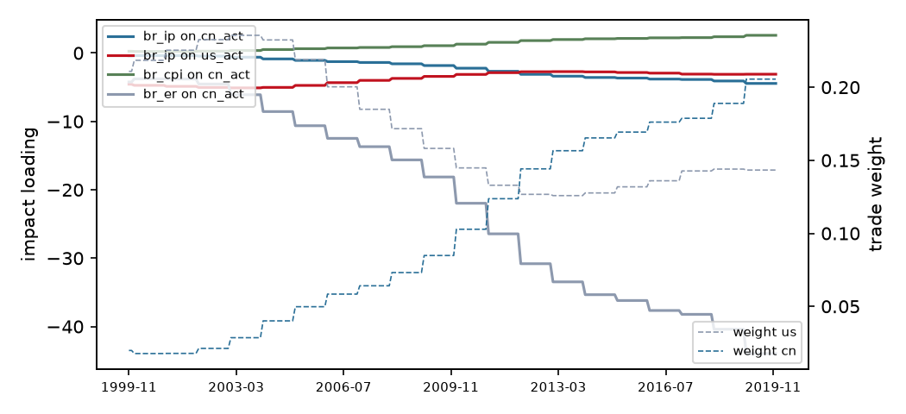

# Trade-weighted block-exogenous SVAR (M1)

Variant **star**, sample 1999-11 to 2019-12 (242 observations), p = 4. Weights are 3-year moving averages of each partner's share of exports plus imports, lagged 1 year(s). Impulse responses hold the weights at the values of each frozen year; 1000 bootstrap draws with the observed weight path, 68% Hall bands; differences are formed draw by draw.

## Frozen weights

| Year | us | cn |
|---|---|---|
| 2000 | 0.218 | 0.018 |
| 2009 | 0.158 | 0.085 |
| 2019 | 0.143 | 0.206 |

## Is the time variation real?

| Test | Statistic | df | chi2 p | bootstrap p |
|---|---|---|---|---|
| LR: weights do not change transmission | 91.82 | 40 | <0.001 |  |
| LR: GVAR star loading is enough | 104.54 | 60 | <0.001 |  |
| LR: weight levels do not enter | 25.39 | 8 | 0.001 |  |
| equal partner slopes Wald | 52.09 | 20 | <0.001 |  |

Bootstrap p-values regenerate the data from the restricted model along the observed weight path and re-estimate both models on every draw, so they do not rely on the chi-square limit, which can over-reject with persistent regressors.

## Headline responses by frozen year

| Response | h | 2000 | 2009 | 2019 | 2009 minus 2000 | 2019 minus 2000 |
|---|---|---|---|---|---|---|
| br_ip to cn_act | 0 | -0.001 [-0.016, +0.003] | -0.008 [-0.061, +0.005] | -0.019 [-0.148, +0.014] | -0.006 [-0.048, +0.006] | -0.018 [-0.136, +0.016] |
| br_ip to cn_act | 3 | +0.007 [-0.039, +0.037] | +0.015 [-0.042, +0.045] | +0.028 [-0.069, +0.074] | +0.008 [-0.019, +0.023] | +0.021 [-0.058, +0.063] |
| br_ip to cn_act | 6 | +0.113 [+0.043, +0.205] | +0.242 [+0.185, +0.346] | +0.455 [+0.377, +0.608] | +0.129 [+0.115, +0.169] * | +0.341 [+0.299, +0.449] * |
| br_ip to cn_act | 12 | +0.788 [+0.752, +1.064] | +0.867 [+0.868, +1.173] | +1.131 [+1.150, +1.561] | +0.079 [+0.072, +0.145] * | +0.343 [+0.329, +0.558] * |
| br_ip to cn_act | 24 | +0.434 [+0.408, +0.826] | +0.325 [+0.296, +0.700] | +0.093 [-0.017, +0.480] | -0.108 [-0.166, -0.088] * | -0.341 [-0.505, -0.276] * |
| br_ip to us_act | 0 | -0.018 [-0.148, +0.018] | -0.014 [-0.113, +0.015] | -0.014 [-0.113, +0.014] | +0.005 [-0.004, +0.036] | +0.005 [-0.003, +0.035] |
| br_ip to us_act | 3 | +0.005 [-0.086, +0.060] | -0.005 [-0.083, +0.040] | -0.015 [-0.098, +0.033] | -0.011 [-0.022, +0.006] | -0.020 [-0.034, -0.005] * |
| br_ip to us_act | 6 | +0.478 [+0.420, +0.612] | +0.388 [+0.331, +0.501] | +0.405 [+0.332, +0.526] | -0.091 [-0.122, -0.084] * | -0.073 [-0.119, -0.059] * |
| br_ip to us_act | 12 | +0.218 [+0.141, +0.423] | +0.210 [+0.129, +0.398] | +0.270 [+0.165, +0.494] | -0.009 [-0.042, +0.011] | +0.052 [-0.008, +0.107] |
| br_ip to us_act | 24 | -0.077 [-0.181, +0.135] | -0.068 [-0.164, +0.149] | -0.101 [-0.199, +0.152] | +0.009 [-0.012, +0.042] | -0.024 [-0.057, +0.060] |
| br_cpi to cn_act | 0 | +0.001 [-0.000, +0.004] | +0.005 [+0.002, +0.014] | +0.011 [+0.005, +0.032] | +0.004 [+0.002, +0.010] * | +0.010 [+0.004, +0.029] * |
| br_cpi to cn_act | 3 | -0.005 [-0.014, +0.004] | -0.012 [-0.027, +0.002] | -0.025 [-0.052, +0.005] | -0.008 [-0.016, +0.002] | -0.020 [-0.044, +0.007] |
| br_cpi to cn_act | 6 | +0.016 [+0.003, +0.044] | -0.001 [-0.025, +0.031] | -0.032 [-0.083, +0.020] | -0.017 [-0.033, -0.007] * | -0.048 [-0.094, -0.017] * |
| br_cpi to cn_act | 12 | -0.010 [-0.061, +0.056] | -0.012 [-0.073, +0.047] | -0.034 [-0.146, +0.038] | -0.002 [-0.029, +0.008] | -0.024 [-0.113, +0.012] |
| br_cpi to cn_act | 24 | -0.026 [-0.177, +0.024] | +0.045 [-0.076, +0.112] | +0.239 [+0.143, +0.380] | +0.071 [+0.068, +0.120] * | +0.265 [+0.251, +0.426] * |
| br_er to cn_act | 0 | -0.014 [-0.037, +0.013] | -0.076 [-0.131, +0.004] | -0.189 [-0.308, +0.001] | -0.063 [-0.099, +0.001] | -0.175 [-0.276, +0.003] |
| br_er to cn_act | 3 | -0.129 [-0.270, -0.011] | -0.372 [-0.578, -0.273] | -0.812 [-1.206, -0.663] | -0.243 [-0.363, -0.200] * | -0.683 [-1.015, -0.562] * |
| br_er to cn_act | 6 | -0.848 [-1.213, -0.660] | -1.257 [-1.758, -1.145] | -2.080 [-2.904, -1.974] | -0.409 [-0.617, -0.405] * | -1.232 [-1.834, -1.197] * |
| br_er to cn_act | 12 | -2.489 [-3.634, -2.477] | -2.242 [-3.393, -2.291] | -2.104 [-3.484, -2.161] | +0.247 [+0.110, +0.346] * | +0.385 [-0.124, +0.590] |
| br_er to cn_act | 24 | +0.237 [-0.625, +0.500] | +0.134 [-0.690, +0.379] | +0.160 [-0.667, +0.585] | -0.103 [-0.194, +0.038] | -0.077 [-0.331, +0.392] |

`*` marks a difference whose band excludes zero.

