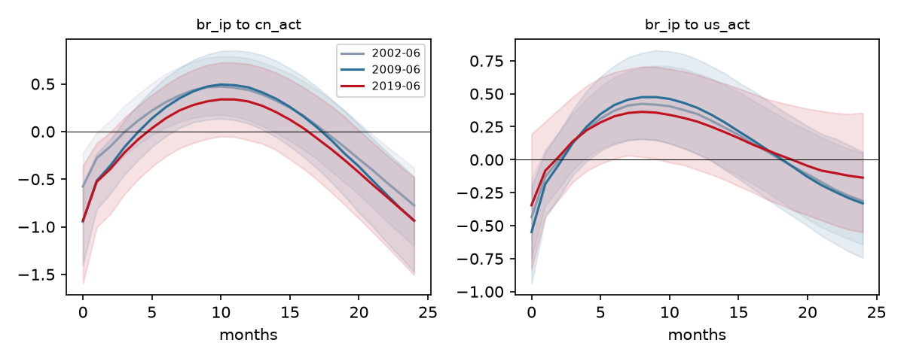

# TVP-VAR with stochastic volatility (M3)

Variables us_act, cn_act, br_ip, br_cpi (first 2 foreign; br_ip, br_cpi as 12-month changes), p = 2, sample 2000-09 to 2019-12. 10000 Gibbs iterations, burn-in 2000, thinning 4, 2000 kept draws, seed 20261014. Priors: k_Q = 0.01, k_S = 0.1, k_W = 0.01, centred on full-sample OLS (no training sample; this makes the prior data-dependent and is a known weakness in short samples).

## MCMC diagnostics

| Block | median inefficiency | max inefficiency | max |Geweke z| |
|---|---|---|---|
| beta | 1.9 | 5.9 | 4.25 |
| a | 2.9 | 6.4 | 3.34 |
| log_var | 3.2 | 4.2 | 2.58 |
| q_diag | 9.0 | 13.6 | 2.59 |

