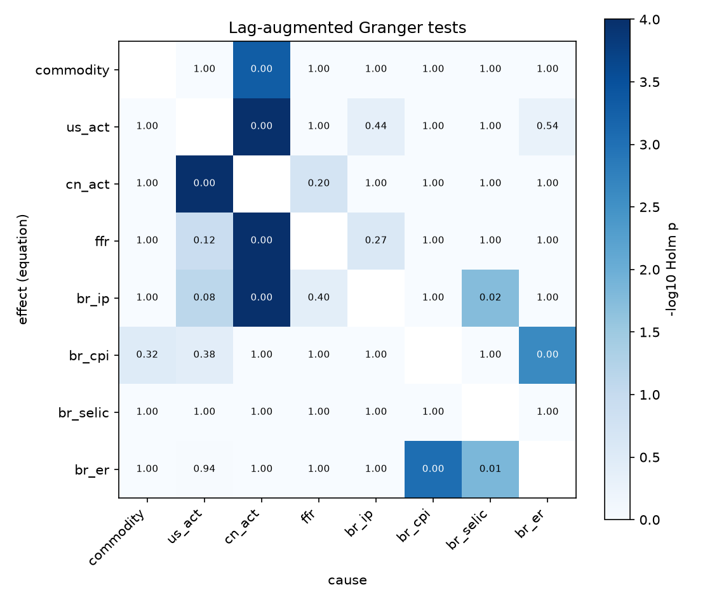
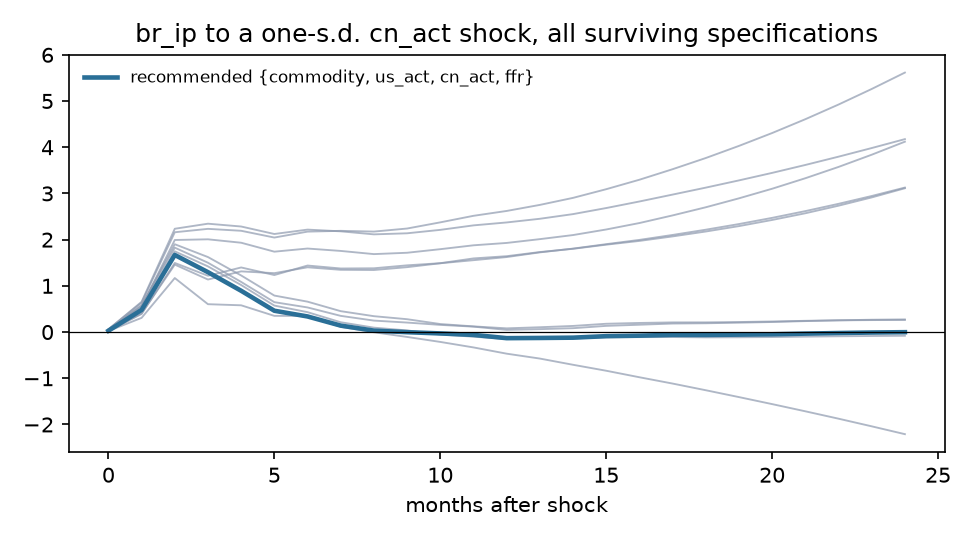
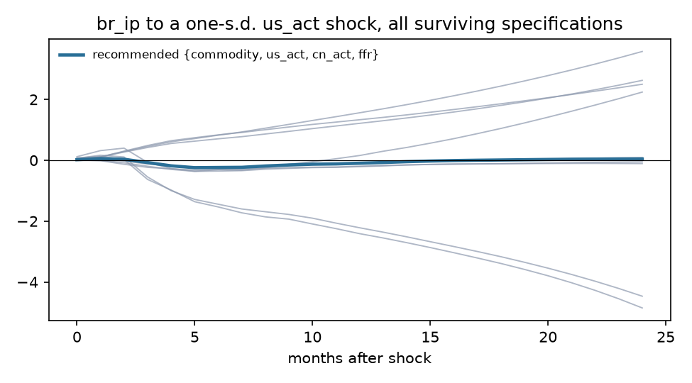
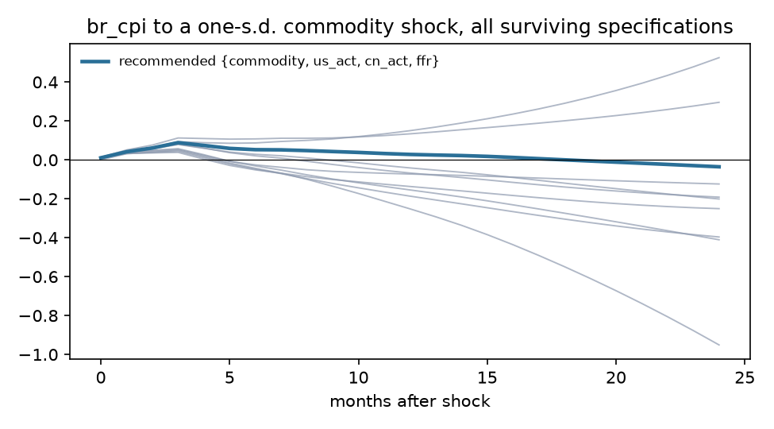
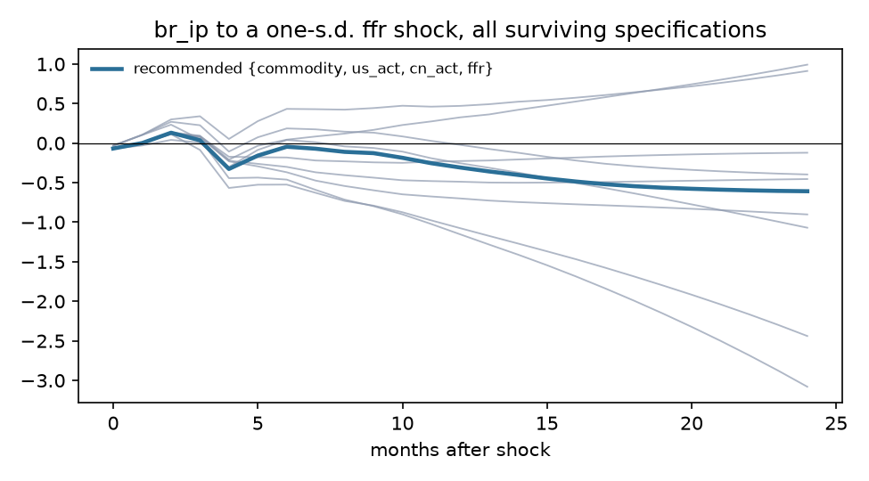

# Exogeneity screen: Brazil

Sample 1997-04 to 2023-11, 320 effective observations, 8 variables, lag order p = 5 (AIC 6, BIC 5, HQ 5), lag augmentation d_max = 1. Deterministic terms: constant, trend, seasonal dummies.

## Recommendation

**Foreign block {commodity, us_act, cn_act, ffr}**, domestic block {br_ip, br_cpi, br_selic, br_er}. Theory grade A (foreign block is exactly the exogenous-by-theory set); statistical verdict **mixed** (lag restriction holds but not weakly exogenous: us_act, ffr).

Runner-up: {commodity, us_act, cn_act}, grade B, verdict mixed, BIC -0.206 against -0.183.

## Stage 1. Integration order

| Variable | Order | ADF p (level) | KPSS p (level) | ADF p (diff) | KPSS p (diff) | Conflict |
|---|---|---|---|---|---|---|
| commodity | I(1) | 0.595 | 0.010 | <0.001 | 0.100 |  |
| us_act | I(0) | 0.008 | 0.100 | <0.001 | 0.100 |  |
| cn_act | I(0) | 0.009 | 0.100 | <0.001 | 0.100 |  |
| ffr | I(1) | 0.244 | 0.010 | 0.001 | 0.100 |  |
| br_ip | I(1) | 0.695 | 0.010 | <0.001 | 0.100 |  |
| br_cpi | I(1) | 0.428 | 0.010 | <0.001 | 0.100 |  |
| br_selic | I(1) | 0.058 | 0.010 | 0.001 | 0.100 |  |
| br_er | I(1) | 0.652 | 0.010 | <0.001 | 0.100 |  |

Johansen trace test: cointegrating rank 2 of 8 at 5%. Weak exogeneity tests are run on the foreign block.

## Stage 3. Pairwise evidence

Lag-augmented (Toda-Yamamoto) Granger p-values, conditional on the whole system, unadjusted. Row is the equation (effect), column the cause. Bold marks pairs that stay below 0.05 after Holm adjustment across all 56 pairs.

| effect \ cause | commodity | us_act | cn_act | ffr | br_ip | br_cpi | br_selic | br_er |
|---|---|---|---|---|---|---|---|---|
| commodity |  | 0.099 | **<0.001** | 0.050 | 0.028 | 0.752 | 0.207 | 0.223 |
| us_act | 0.085 |  | **<0.001** | 0.615 | 0.011 | 0.380 | 0.789 | 0.014 |
| cn_act | 0.255 | **<0.001** |  | 0.004 | 0.675 | 0.109 | 0.942 | 0.832 |
| ffr | 0.113 | 0.003 | **<0.001** |  | 0.006 | 0.774 | 0.112 | 0.716 |
| br_ip | 0.032 | 0.002 | **<0.001** | 0.010 |  | 0.231 | **<0.001** | 0.370 |
| br_cpi | 0.007 | 0.009 | 0.041 | 0.328 | 0.350 |  | 0.746 | **<0.001** |
| br_selic | 0.875 | 0.618 | 0.898 | 0.707 | 0.495 | 0.349 |  | 0.241 |
| br_er | 0.129 | 0.025 | 0.033 | 0.749 | 0.027 | **<0.001** | **<0.001** |  |

DirectLiNGAM causal order of the reduced-form residuals (advisory; needs non-Gaussian residuals, 100% of series reject normality): **br_selic > br_cpi > ffr > us_act > cn_act > commodity > br_ip > br_er**.

| Pair | Pairwise direction | R |
|---|---|---|
| commodity, br_ip | commodity -> br_ip | +0.0009 |
| commodity, br_cpi | commodity -> br_cpi | +0.0010 |
| commodity, br_selic | br_selic -> commodity | -0.0000 |
| commodity, br_er | commodity -> br_er | +0.0044 |
| us_act, br_ip | us_act -> br_ip | +0.0002 |
| us_act, br_cpi | us_act -> br_cpi | +0.0003 |
| us_act, br_selic | br_selic -> us_act | -0.0000 |
| us_act, br_er | us_act -> br_er | +0.0000 |
| cn_act, br_ip | cn_act -> br_ip | +0.0004 |
| cn_act, br_cpi | br_cpi -> cn_act | -0.0000 |
| cn_act, br_selic | br_selic -> cn_act | -0.0008 |
| cn_act, br_er | cn_act -> br_er | +0.0010 |
| ffr, br_ip | br_ip -> ffr | -0.0005 |
| ffr, br_cpi | br_cpi -> ffr | -0.0019 |
| ffr, br_selic | br_selic -> ffr | -0.0009 |
| ffr, br_er | ffr -> br_er | +0.0020 |

## Stage 4 and 5. Candidate specifications

LA-Wald is the primary test (domestic lags excluded from foreign equations, robust to unit roots); its p-value is bootstrapped under the null (Hacker and Hatemi-J 2006) because the asymptotic version over-rejects in samples this size. Holm p adjusts the bootstrap p across every admissible candidate. LR is the Sims-corrected likelihood ratio of change 0002. Inst. p tests residual correlation between blocks (rejection is expected and is what the recursive impact matrix orders). CW is the Clark-West out-of-sample test that domestic lags improve foreign forecasts. LiNGAM agree is the share of foreign-domestic pairs the data-driven causal order puts foreign first, with the bootstrap 5th percentile.

| Rank | Foreign block | Theory | Verdict | LA-Wald asym. p | LA-Wald boot p | Holm p | LR p | Inst. p | Not weakly exog. | CW Holm p | BIC | LiNGAM agree (5%) | Max root |
|---|---|---|---|---|---|---|---|---|---|---|---|---|---|
| 1 | {commodity, us_act, cn_act, ffr} | A | mixed | 0.003 | 0.040 | 0.198 | <0.001 | 0.001 | us_act, ffr | 1.000 | -0.183 | 0.50 (0.19) | 0.974 |
| 2 | {commodity, us_act, cn_act} | B | mixed | <0.001 | 0.028 | 0.198 | 0.008 | <0.001 | us_act | 1.000 | -0.206 | 0.40 (0.13) | 0.974 |
| 3 | {us_act, cn_act, ffr} | B | mixed | 0.001 | 0.029 | 0.198 | <0.001 | <0.001 | us_act, ffr | 1.000 | -0.059 | 0.60 (0.27) | 0.979 |
| 4 | {us_act, cn_act} | B | mixed | <0.001 | 0.035 | 0.198 | <0.001 | 0.031 | us_act, cn_act | 1.000 | 0.011 | 0.50 (0.17) | 0.984 |
| 5 | {commodity, cn_act, ffr} | B | mixed | <0.001 | 0.111 | 0.333 | <0.001 | <0.001 | cn_act, ffr | 0.563 | 0.049 | 0.47 (0.20) | 1.059 |
| 6 | {cn_act, ffr} | B | mixed | <0.001 | 0.005 | 0.050 | <0.001 | <0.001 | cn_act, ffr | 1.000 | 0.172 | 0.58 (0.17) | 1.030 |
| 7 | {cn_act} | B | mixed | <0.001 | 0.005 | 0.050 | <0.001 | 0.002 | cn_act | 0.922 | 0.322 | 0.43 (0.00) | 1.015 |
| 8 | {commodity, us_act, ffr} | B | mixed | <0.001 | 0.007 | 0.060 | <0.001 | <0.001 | us_act, ffr | 0.332 | 3.023 | 0.53 (0.20) | 1.048 |
| 9 | {us_act, ffr} | B | mixed | <0.001 | 0.302 | 0.603 | <0.001 | <0.001 | us_act, ffr | 0.217 | 3.172 | 0.67 (0.25) | 1.067 |
| 10 | {us_act} | B | mixed | <0.001 | 0.472 | 0.603 | <0.001 | <0.001 | us_act | 0.098 | 3.344 | 0.57 (0.14) | 1.078 |
| 11 | {commodity, cn_act} | B | rejected | <0.001 | 0.004 | 0.046 | <0.001 | <0.001 | cn_act | 0.269 | 0.085 | 0.33 (0.08) | 1.047 |
| 12 | {commodity} | B | rejected | <0.001 | <0.001 | 0.013 | 0.002 | <0.001 | none | 0.909 | 0.209 | 0.29 (0.00) | 0.982 |
| 13 | {commodity, ffr} | B | rejected | <0.001 | <0.001 | 0.013 | <0.001 | <0.001 | ffr | 0.397 | 0.211 | 0.50 (0.17) | 0.974 |
| 14 | {ffr} | B | rejected | <0.001 | <0.001 | 0.013 | <0.001 | <0.001 | ffr | 0.208 | 0.418 | 0.71 (0.00) | 0.977 |
| 15 | {commodity, us_act} | B | rejected | <0.001 | 0.002 | 0.020 | <0.001 | <0.001 | us_act | 0.207 | 3.082 | 0.42 (0.08) | 1.054 |

## Stage 6. Robustness of headline responses

- **br_ip to a cn_act shock**: recommended specification peaks at +1.6683 at horizon 2; 12 of 12 surviving specifications and orderings have the same sign there.

- **br_ip to a us_act shock**: recommended specification peaks at -0.2415 at horizon 5; 9 of 12 surviving specifications and orderings have the same sign there.

- **br_cpi to a commodity shock**: recommended specification peaks at +0.0885 at horizon 3; 12 of 12 surviving specifications and orderings have the same sign there.

- **br_ip to a ffr shock**: recommended specification peaks at -0.6081 at horizon 24; 10 of 12 surviving specifications and orderings have the same sign there.

## Theory file

| Variable | Prior | Rationale | Source |
|---|---|---|---|
| commodity | exogenous | World commodity price index. Brazil is a large exporter of soybeans and iron ore, so it is not a pure price taker in every market, but the all-commodity index is dominated by energy, where Brazil has no pricing power at a monthly frequency. | Kim and Roubini (2000); Cesa-Bianchi et al. (2012) on the commodity channel |
| us_act | exogenous | U.S. activity. Brazil's economy is under a tenth the size of the U.S. economy and U.S. exports to Brazil are about 1% of U.S. GDP; no plausible monthly feedback. | Cushman and Zha (1997); Mackowiak (2007) |
| cn_act | exogenous | China activity. Brazil is China's main soybean and a major iron ore supplier, which makes this the weakest exogeneity claim in the model; the screen tests it. | Cesa-Bianchi et al. (2012) |
| ffr | exogenous | U.S. policy rate; the FOMC does not react to Brazilian conditions. | Cushman and Zha (1997) |
| br_ip | endogenous | Domestic activity. |  |
| br_cpi | endogenous | Domestic prices. |  |
| br_selic | endogenous | Policy rate under inflation targeting since June 1999; reacts to domestic inflation and activity. | Banco Central do Brasil inflation-targeting regime |
| br_er | endogenous | Floating real per dollar since January 1999; reacts to domestic and foreign shocks within the month. | Banco Central do Brasil exchange-rate regime |
