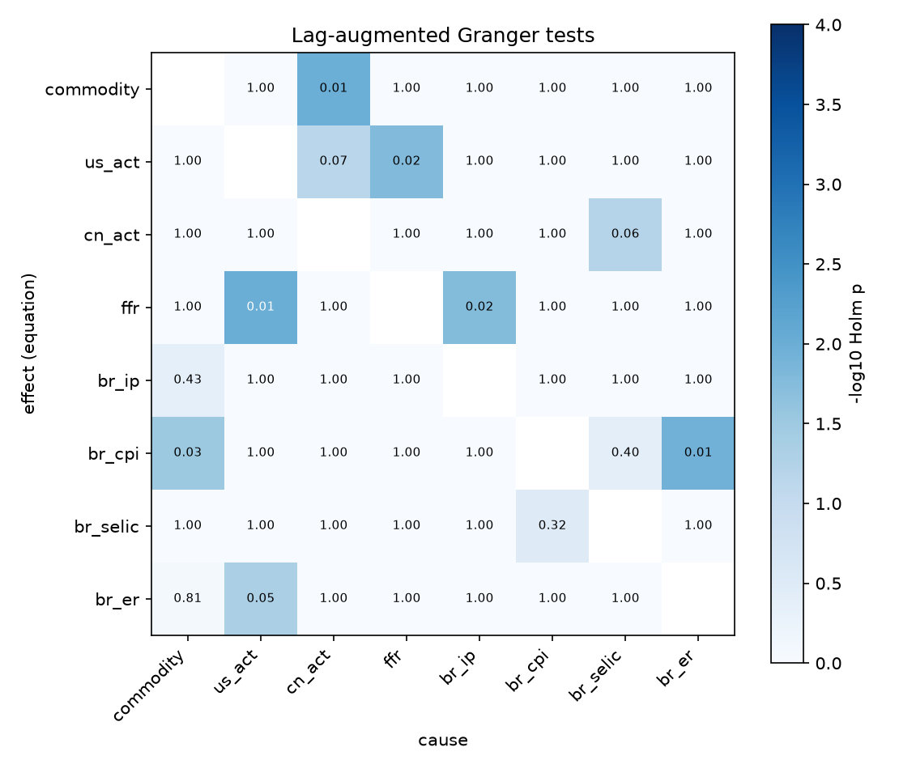
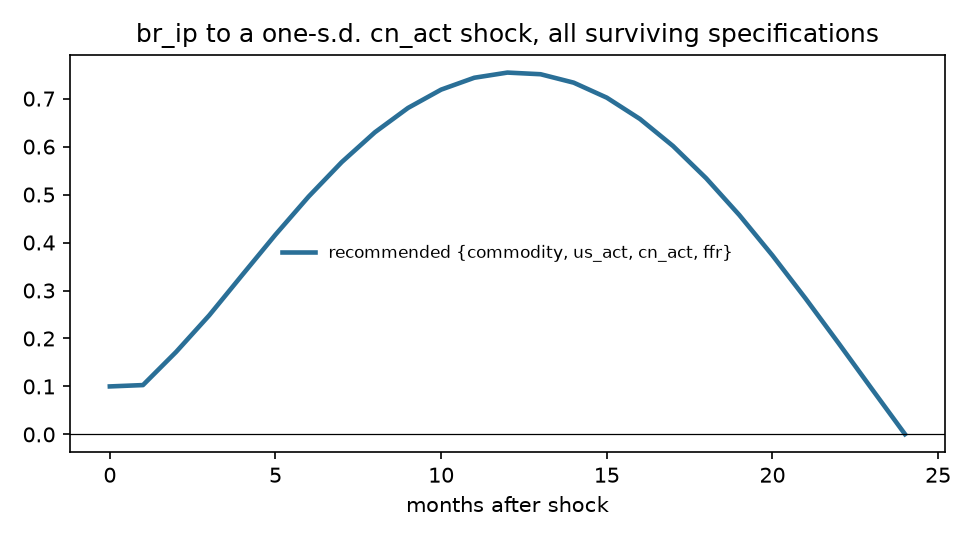
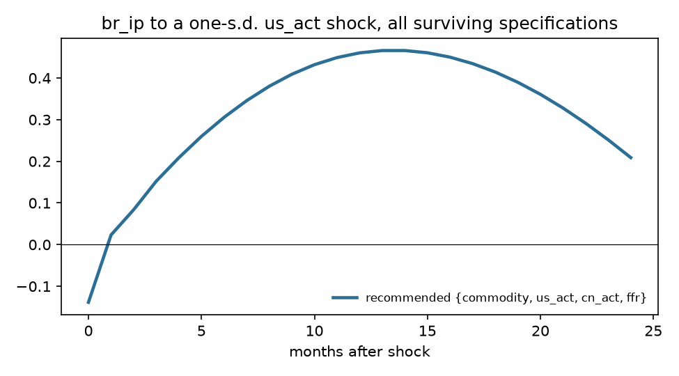
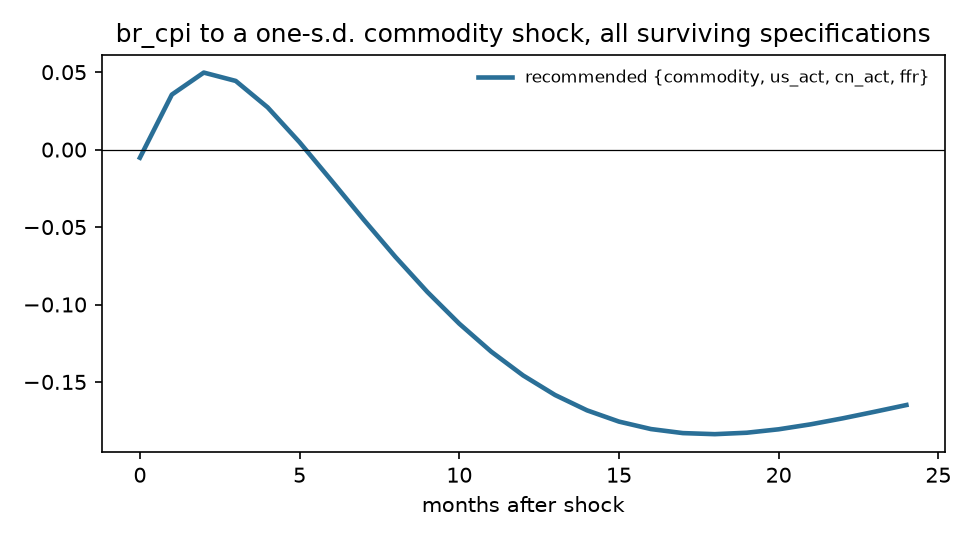
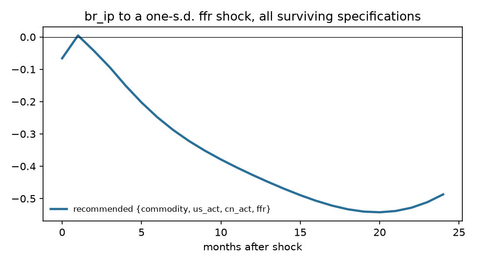

# Exogeneity screen: Brazil

Sample 1999-10 to 2019-12, 243 effective observations, 8 variables, lag order p = 2 (AIC 6, BIC 4, HQ 5), lag augmentation d_max = 1. Deterministic terms: constant, trend, seasonal dummies.

## Recommendation

**Foreign block {commodity, us_act, cn_act, ffr}**, domestic block {br_ip, br_cpi, br_selic, br_er}. Theory grade A (foreign block is exactly the exogenous-by-theory set); statistical verdict **rejected** (domestic lags Granger-cause the foreign block (Holm p = 0.04)).

Runner-up: {ffr}, grade B, verdict rejected, BIC -16.097 against -15.977.

## Stage 1. Integration order

| Variable | Order | ADF p (level) | KPSS p (level) | ADF p (diff) | KPSS p (diff) | Conflict |
|---|---|---|---|---|---|---|
| commodity | I(1) | 0.767 | 0.010 | <0.001 | 0.100 |  |
| us_act | I(0) | 0.048 | 0.100 | 0.001 | 0.100 |  |
| cn_act | I(1) | 0.399 | 0.010 | <0.001 | 0.100 |  |
| ffr | I(1) | 0.004 | 0.027 | 0.009 | 0.100 | yes |
| br_ip | I(1) | 0.814 | 0.010 | <0.001 | 0.079 |  |
| br_cpi | I(1) | 0.290 | 0.010 | 0.007 | 0.095 |  |
| br_selic | I(1) | 0.106 | 0.037 | <0.001 | 0.100 |  |
| br_er | I(1) | 0.815 | 0.010 | <0.001 | 0.100 |  |

Johansen trace test: cointegrating rank 3 of 8 at 5%. Weak exogeneity tests are run on the foreign block.

## Stage 3. Pairwise evidence

Lag-augmented (Toda-Yamamoto) Granger p-values, conditional on the whole system, unadjusted. Row is the equation (effect), column the cause. Bold marks pairs that stay below 0.05 after Holm adjustment across all 56 pairs.

| effect \ cause | commodity | us_act | cn_act | ffr | br_ip | br_cpi | br_selic | br_er |
|---|---|---|---|---|---|---|---|---|
| commodity |  | 0.570 | **<0.001** | 0.033 | 0.910 | 0.350 | 0.996 | 0.244 |
| us_act | 0.083 |  | 0.001 | **<0.001** | 0.337 | 0.639 | 0.422 | 0.191 |
| cn_act | 0.054 | 0.028 |  | 0.100 | 0.882 | 0.054 | 0.001 | 0.046 |
| ffr | 0.301 | **<0.001** | 0.247 |  | **<0.001** | 0.116 | 0.607 | 0.793 |
| br_ip | 0.010 | 0.462 | 0.239 | 0.826 |  | 0.309 | 0.610 | 0.492 |
| br_cpi | **<0.001** | 0.113 | 0.250 | 0.817 | 0.113 |  | 0.009 | **<0.001** |
| br_selic | 0.475 | 0.671 | 0.051 | 0.956 | 0.289 | 0.007 |  | 0.844 |
| br_er | 0.018 | **<0.001** | 0.252 | 0.138 | 0.582 | 0.396 | 0.856 |  |

DirectLiNGAM causal order of the reduced-form residuals (advisory; needs non-Gaussian residuals, 88% of series reject normality): **br_cpi > commodity > cn_act > us_act > ffr > br_ip > br_selic > br_er**.

| Pair | Pairwise direction | R |
|---|---|---|
| commodity, br_ip | commodity -> br_ip | +0.0007 |
| commodity, br_cpi | br_cpi -> commodity | -0.0000 |
| commodity, br_selic | br_selic -> commodity | -0.0001 |
| commodity, br_er | commodity -> br_er | +0.0093 |
| cn_act, br_ip | cn_act -> br_ip | +0.0001 |
| cn_act, br_cpi | br_cpi -> cn_act | -0.0005 |
| cn_act, br_selic | cn_act -> br_selic | +0.0016 |
| cn_act, br_er | br_er -> cn_act | -0.0002 |
| ffr, br_ip | br_ip -> ffr | -0.0006 |
| ffr, br_cpi | br_cpi -> ffr | -0.0023 |
| ffr, br_selic | ffr -> br_selic | +0.0016 |
| ffr, br_er | ffr -> br_er | +0.0014 |

## Stage 4 and 5. Candidate specifications

LA-Wald is the primary test (domestic lags excluded from foreign equations, robust to unit roots); its p-value is bootstrapped under the null (Hacker and Hatemi-J 2006) because the asymptotic version over-rejects in samples this size. Holm p adjusts the bootstrap p across every admissible candidate. LR is the Sims-corrected likelihood ratio of change 0002. Inst. p tests residual correlation between blocks (rejection is expected and is what the recursive impact matrix orders). CW is the Clark-West out-of-sample test that domestic lags improve foreign forecasts. LiNGAM agree is the share of foreign-domestic pairs the data-driven causal order puts foreign first, with the bootstrap 5th percentile.

| Rank | Foreign block | Theory | Verdict | LA-Wald asym. p | LA-Wald boot p | Holm p | LR p | Inst. p | Not weakly exog. | CW Holm p | BIC | LiNGAM agree (5%) | Max root |
|---|---|---|---|---|---|---|---|---|---|---|---|---|---|
| 1 | {commodity, us_act, cn_act, ffr} | A | rejected | 0.010 | 0.029 | 0.040 | <0.001 | <0.001 | cn_act, ffr | 0.263 | -15.977 | 0.75 (0.12) | 0.993 |
| 2 | {ffr} | B | rejected | <0.001 | 0.003 | 0.018 | <0.001 | <0.001 | ffr | 0.151 | -16.097 | 0.43 (0.00) | 0.988 |
| 3 | {commodity} | B | rejected | <0.001 | 0.009 | 0.028 | <0.001 | <0.001 | commodity | 0.251 | -16.076 | 0.86 (0.14) | 0.994 |
| 4 | {us_act, ffr} | B | rejected | 0.002 | 0.020 | 0.040 | <0.001 | <0.001 | us_act, ffr | 0.070 | -16.043 | 0.50 (0.08) | 1.003 |
| 5 | {commodity, cn_act} | B | rejected | <0.001 | 0.002 | 0.015 | <0.001 | <0.001 | commodity, cn_act | 0.806 | -16.025 | 0.83 (0.33) | 0.994 |
| 6 | {commodity, ffr} | B | rejected | <0.001 | <0.001 | 0.013 | <0.001 | <0.001 | commodity, ffr | 0.311 | -16.011 | 0.67 (0.17) | 0.993 |
| 7 | {commodity, us_act, ffr} | B | rejected | <0.001 | 0.005 | 0.025 | <0.001 | <0.001 | us_act, ffr | 0.968 | -15.991 | 0.67 (0.13) | 1.016 |
| 8 | {commodity, cn_act, ffr} | B | rejected | <0.001 | 0.003 | 0.018 | <0.001 | <0.001 | commodity, cn_act, ffr | 0.023 | -15.935 | 0.73 (0.27) | 0.993 |
| 9 | {us_act} | B | rejected | <0.001 | <0.001 | 0.013 | <0.001 | <0.001 | us_act | 0.005 | -15.908 | 0.57 (0.00) | 0.994 |
| 10 | {cn_act} | B | rejected | <0.001 | <0.001 | 0.013 | <0.001 | <0.001 | cn_act | <0.001 | -15.887 | 0.71 (0.00) | 0.996 |
| 11 | {commodity, us_act} | B | rejected | <0.001 | <0.001 | 0.013 | <0.001 | <0.001 | us_act | 0.354 | -15.879 | 0.75 (0.08) | 1.000 |
| 12 | {cn_act, ffr} | B | rejected | <0.001 | <0.001 | 0.013 | <0.001 | <0.001 | cn_act, ffr | <0.001 | -15.817 | 0.58 (0.17) | 0.995 |
| 13 | {us_act, cn_act, ffr} | B | rejected | <0.001 | 0.002 | 0.015 | <0.001 | <0.001 | us_act, cn_act, ffr | 0.002 | -15.799 | 0.60 (0.13) | 0.994 |
| 14 | {commodity, us_act, cn_act} | B | rejected | 0.003 | 0.007 | 0.027 | <0.001 | <0.001 | us_act, cn_act | 0.012 | -15.658 | 0.80 (0.20) | 0.990 |
| 15 | {us_act, cn_act} | B | rejected | <0.001 | <0.001 | 0.013 | <0.001 | <0.001 | us_act, cn_act | <0.001 | -15.554 | 0.67 (0.08) | 0.992 |

## Stage 6. Robustness of headline responses

- **br_ip to a cn_act shock**: recommended specification peaks at +0.7543 at horizon 12; 2 of 2 surviving specifications and orderings have the same sign there.

- **br_ip to a us_act shock**: recommended specification peaks at +0.4659 at horizon 14; 2 of 2 surviving specifications and orderings have the same sign there.

- **br_cpi to a commodity shock**: recommended specification peaks at -0.1837 at horizon 18; 2 of 2 surviving specifications and orderings have the same sign there.

- **br_ip to a ffr shock**: recommended specification peaks at -0.5423 at horizon 20; 2 of 2 surviving specifications and orderings have the same sign there.

## Theory file

| Variable | Prior | Rationale | Source |
|---|---|---|---|
| commodity | exogenous | World commodity price index. Brazil is a large exporter of soybeans and iron ore, so it is not a pure price taker in every market, but the all-commodity index is dominated by energy, where Brazil has no pricing power at a monthly frequency. | Kim and Roubini (2000); Cesa-Bianchi et al. (2012) on the commodity channel |
| us_act | exogenous | U.S. activity. Brazil's economy is under a tenth the size of the U.S. economy and U.S. exports to Brazil are about 1% of U.S. GDP; no plausible monthly feedback. | Cushman and Zha (1997); Mackowiak (2007) |
| cn_act | exogenous | China activity. Brazil is China's main soybean and a major iron ore supplier, which makes this the weakest exogeneity claim in the model; the screen tests it. | Cesa-Bianchi et al. (2012) |
| ffr | exogenous | U.S. policy rate; the FOMC does not react to Brazilian conditions. | Cushman and Zha (1997) |
| br_ip | endogenous | Domestic activity. |  |
| br_cpi | endogenous | Domestic prices. |  |
| br_selic | endogenous | Policy rate under inflation targeting since June 1999; reacts to domestic inflation and activity. | Banco Central do Brasil inflation-targeting regime |
| br_er | endogenous | Floating real per dollar since January 1999; reacts to domestic and foreign shocks within the month. | Banco Central do Brasil exchange-rate regime |
