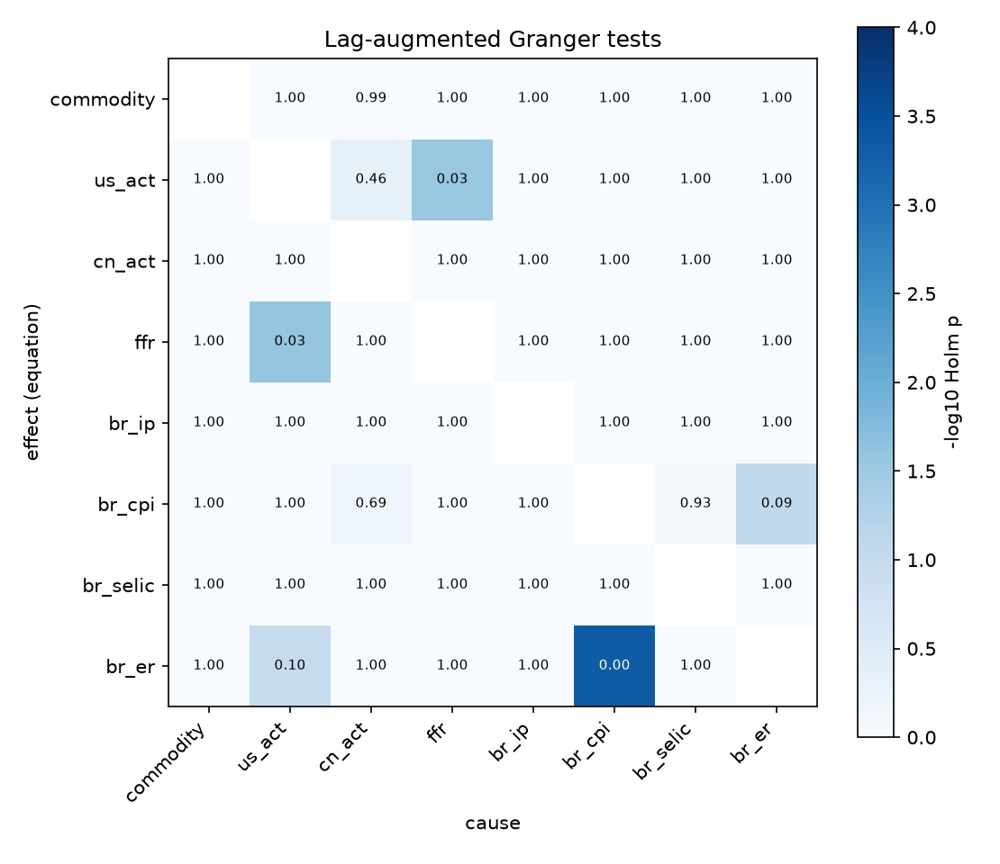
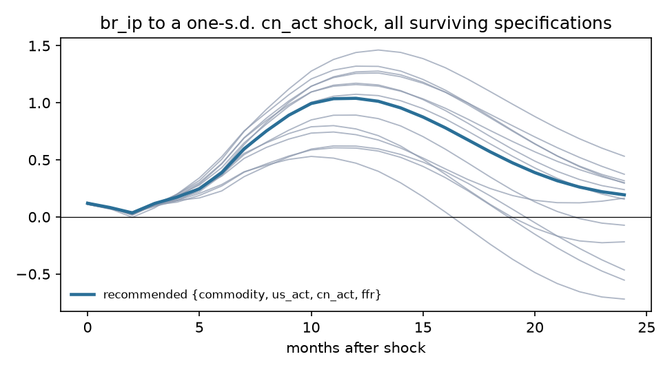
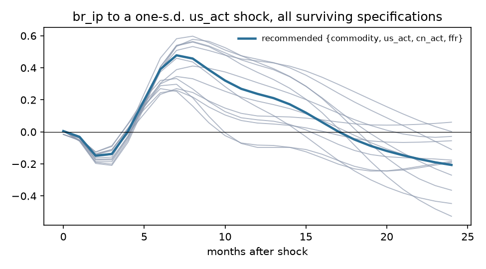
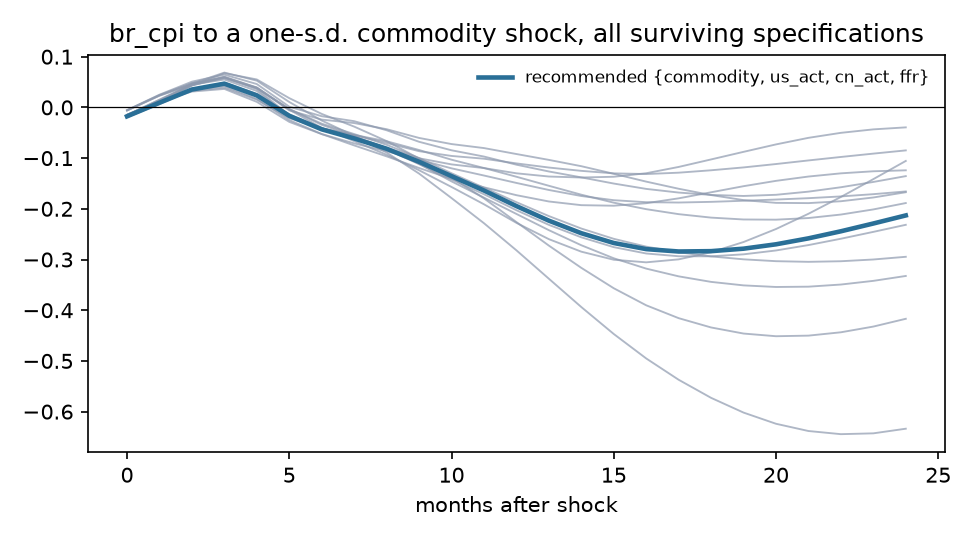
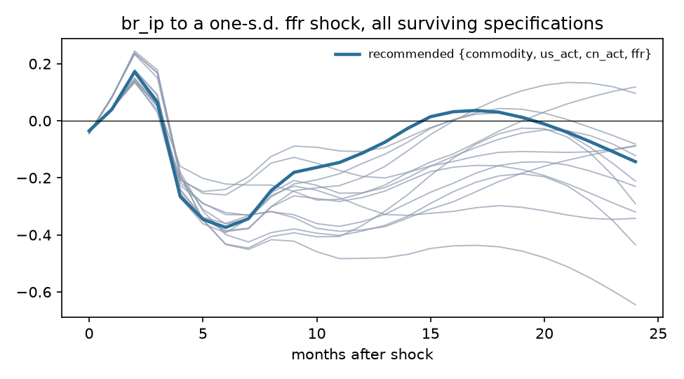

# Exogeneity screen: Brazil

Sample 2000-02 to 2019-12, 239 effective observations, 8 variables, lag order p = 6 (AIC 6, BIC 4, HQ 5), lag augmentation d_max = 1. Deterministic terms: constant, trend, seasonal dummies.

## Recommendation

**Foreign block {commodity, us_act, cn_act, ffr}**, domestic block {br_ip, br_cpi, br_selic, br_er}. Theory grade A (foreign block is exactly the exogenous-by-theory set); statistical verdict **mixed** (lag restriction holds but not weakly exogenous: ffr).

Runner-up: {commodity, cn_act}, grade B, verdict supported, BIC -19.127 against -19.369.

## Stage 1. Integration order

| Variable | Order | ADF p (level) | KPSS p (level) | ADF p (diff) | KPSS p (diff) | Conflict |
|---|---|---|---|---|---|---|
| commodity | I(1) | 0.767 | 0.010 | <0.001 | 0.100 |  |
| us_act | I(0) | 0.048 | 0.100 | 0.001 | 0.100 |  |
| cn_act | I(1) | 0.399 | 0.010 | <0.001 | 0.100 |  |
| ffr | I(1) | 0.004 | 0.027 | 0.009 | 0.100 | yes |
| br_ip | I(1) | 0.814 | 0.010 | <0.001 | 0.079 |  |
| br_cpi | I(1) | 0.290 | 0.010 | 0.007 | 0.095 |  |
| br_selic | I(1) | 0.106 | 0.037 | <0.001 | 0.100 |  |
| br_er | I(1) | 0.815 | 0.010 | <0.001 | 0.100 |  |

Johansen trace test: cointegrating rank 2 of 8 at 5%. Weak exogeneity tests are run on the foreign block.

## Stage 3. Pairwise evidence

Lag-augmented (Toda-Yamamoto) Granger p-values, conditional on the whole system, unadjusted. Row is the equation (effect), column the cause. Bold marks pairs that stay below 0.05 after Holm adjustment across all 56 pairs.

| effect \ cause | commodity | us_act | cn_act | ffr | br_ip | br_cpi | br_selic | br_er |
|---|---|---|---|---|---|---|---|---|
| commodity |  | 0.568 | 0.021 | 0.102 | 0.143 | 0.711 | 0.305 | 0.333 |
| us_act | 0.372 |  | 0.009 | **<0.001** | 0.200 | 0.256 | 0.136 | 0.978 |
| cn_act | 0.162 | 0.390 |  | 0.406 | 0.926 | 0.212 | 0.036 | 0.353 |
| ffr | 0.129 | **<0.001** | 0.834 |  | 0.028 | 0.404 | 0.907 | 0.253 |
| br_ip | 0.331 | 0.322 | 0.091 | 0.245 |  | 0.614 | 0.032 | 0.188 |
| br_cpi | 0.030 | 0.657 | 0.014 | 0.628 | 0.641 |  | 0.019 | 0.002 |
| br_selic | 0.262 | 0.953 | 0.175 | 0.899 | 0.053 | 0.646 |  | 0.109 |
| br_er | 0.115 | 0.002 | 0.722 | 0.484 | 0.095 | **<0.001** | 0.548 |  |

DirectLiNGAM causal order of the reduced-form residuals (advisory; needs non-Gaussian residuals, 75% of series reject normality): **cn_act > br_cpi > commodity > us_act > ffr > br_selic > br_er > br_ip**.

| Pair | Pairwise direction | R |
|---|---|---|
| us_act, br_ip | us_act -> br_ip | +0.0000 |
| us_act, br_cpi | us_act -> br_cpi | +0.0003 |
| us_act, br_selic | us_act -> br_selic | +0.0031 |
| cn_act, br_ip | cn_act -> br_ip | +0.0003 |
| cn_act, br_cpi | cn_act -> br_cpi | +0.0003 |
| cn_act, br_selic | br_selic -> cn_act | -0.0000 |
| ffr, br_ip | br_ip -> ffr | -0.0006 |
| ffr, br_cpi | br_cpi -> ffr | -0.0048 |
| ffr, br_selic | br_selic -> ffr | -0.0009 |

## Stage 4 and 5. Candidate specifications

LA-Wald is the primary test (domestic lags excluded from foreign equations, robust to unit roots); its p-value is bootstrapped under the null (Hacker and Hatemi-J 2006) because the asymptotic version over-rejects in samples this size. Holm p adjusts the bootstrap p across every admissible candidate. LR is the Sims-corrected likelihood ratio of change 0002. Inst. p tests residual correlation between blocks (rejection is expected and is what the recursive impact matrix orders). CW is the Clark-West out-of-sample test that domestic lags improve foreign forecasts. LiNGAM agree is the share of foreign-domestic pairs the data-driven causal order puts foreign first, with the bootstrap 5th percentile.

| Rank | Foreign block | Theory | Verdict | LA-Wald asym. p | LA-Wald boot p | Holm p | LR p | Inst. p | Not weakly exog. | CW Holm p | BIC | LiNGAM agree (5%) | Max root |
|---|---|---|---|---|---|---|---|---|---|---|---|---|---|
| 1 | {commodity, us_act, cn_act, ffr} | A | mixed | 0.117 | 0.263 | 0.533 | 0.045 | <0.001 | ffr | 0.193 | -19.369 | 0.81 (0.25) | 0.978 |
| 2 | {commodity, cn_act} | B | supported | 0.044 | 0.133 | 0.533 | 0.192 | <0.001 | none | 1.000 | -19.127 | 0.92 (0.17) | 0.979 |
| 3 | {cn_act} | B | supported | 0.031 | 0.096 | 0.479 | 0.160 | 0.019 | none | 0.329 | -18.729 | 1.00 (0.14) | 0.978 |
| 4 | {us_act, cn_act, ffr} | B | mixed | 0.059 | 0.171 | 0.533 | 0.024 | <0.001 | ffr | 0.016 | -19.267 | 0.73 (0.33) | 0.977 |
| 5 | {commodity, us_act, cn_act} | B | mixed | 0.005 | 0.046 | 0.367 | 0.022 | <0.001 | none | 0.252 | -19.264 | 0.87 (0.26) | 0.979 |
| 6 | {commodity, cn_act, ffr} | B | mixed | 0.007 | 0.062 | 0.385 | 0.015 | <0.001 | ffr | 0.563 | -19.249 | 0.80 (0.20) | 0.980 |
| 7 | {commodity, us_act, ffr} | B | mixed | 0.007 | 0.055 | 0.385 | <0.001 | <0.001 | ffr | 0.282 | -19.147 | 0.60 (0.13) | 0.985 |
| 8 | {us_act, cn_act} | B | mixed | 0.005 | 0.033 | 0.308 | 0.036 | 0.337 | none | 0.081 | -19.055 | 0.83 (0.33) | 0.971 |
| 9 | {us_act, ffr} | B | mixed | 0.102 | 0.242 | 0.533 | 0.007 | <0.001 | ffr | 0.115 | -18.998 | 0.50 (0.08) | 0.992 |
| 10 | {cn_act, ffr} | B | mixed | 0.002 | 0.021 | 0.240 | 0.003 | <0.001 | ffr | 0.079 | -18.977 | 0.75 (0.25) | 0.982 |
| 11 | {commodity, ffr} | B | mixed | <0.001 | 0.013 | 0.163 | <0.001 | <0.001 | commodity, ffr | 0.138 | -18.910 | 0.58 (0.00) | 0.997 |
| 12 | {us_act} | B | mixed | <0.001 | 0.011 | 0.152 | 0.014 | 0.049 | none | 0.475 | -18.652 | 0.57 (0.00) | 0.993 |
| 13 | {ffr} | B | mixed | 0.004 | 0.031 | 0.308 | 0.006 | <0.001 | ffr | 0.228 | -18.630 | 0.43 (0.00) | 0.989 |
| 14 | {commodity} | B | mixed | 0.002 | 0.020 | 0.240 | 0.005 | <0.001 | commodity | 0.083 | -18.624 | 0.71 (0.00) | 1.002 |
| 15 | {commodity, us_act} | B | rejected | <0.001 | 0.002 | 0.025 | <0.001 | <0.001 | none | 0.508 | -18.922 | 0.67 (0.17) | 1.002 |

## Stage 6. Robustness of headline responses

- **br_ip to a cn_act shock**: recommended specification peaks at +1.0394 at horizon 12; 16 of 16 surviving specifications and orderings have the same sign there.

- **br_ip to a us_act shock**: recommended specification peaks at +0.4782 at horizon 7; 16 of 16 surviving specifications and orderings have the same sign there.

- **br_cpi to a commodity shock**: recommended specification peaks at -0.2842 at horizon 17; 16 of 16 surviving specifications and orderings have the same sign there.

- **br_ip to a ffr shock**: recommended specification peaks at -0.3738 at horizon 6; 16 of 16 surviving specifications and orderings have the same sign there.

## Theory file

| Variable | Prior | Rationale | Source |
|---|---|---|---|
| commodity | exogenous | World commodity price index. Brazil is a large exporter of soybeans and iron ore, so it is not a pure price taker in every market, but the all-commodity index is dominated by energy, where Brazil has no pricing power at a monthly frequency. | Kim and Roubini (2000); Cesa-Bianchi et al. (2012) on the commodity channel |
| us_act | exogenous | U.S. activity. Brazil's economy is under a tenth the size of the U.S. economy and U.S. exports to Brazil are about 1% of U.S. GDP; no plausible monthly feedback. | Cushman and Zha (1997); Mackowiak (2007) |
| cn_act | exogenous | China activity. Brazil is China's main soybean and a major iron ore supplier, which makes this the weakest exogeneity claim in the model; the screen tests it. | Cesa-Bianchi et al. (2012) |
| ffr | exogenous | U.S. policy rate; the FOMC does not react to Brazilian conditions. | Cushman and Zha (1997) |
| br_ip | endogenous | Domestic activity. |  |
| br_cpi | endogenous | Domestic prices. |  |
| br_selic | endogenous | Policy rate under inflation targeting since June 1999; reacts to domestic inflation and activity. | Banco Central do Brasil inflation-targeting regime |
| br_er | endogenous | Floating real per dollar since January 1999; reacts to domestic and foreign shocks within the month. | Banco Central do Brasil exchange-rate regime |
