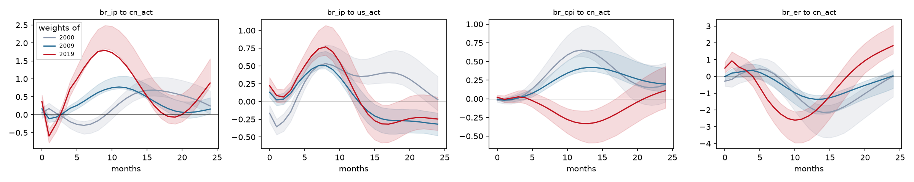
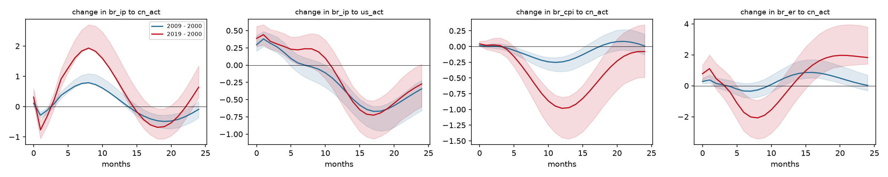
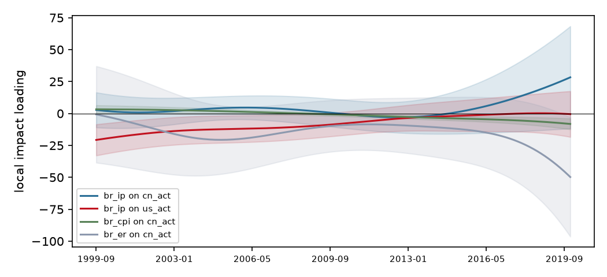
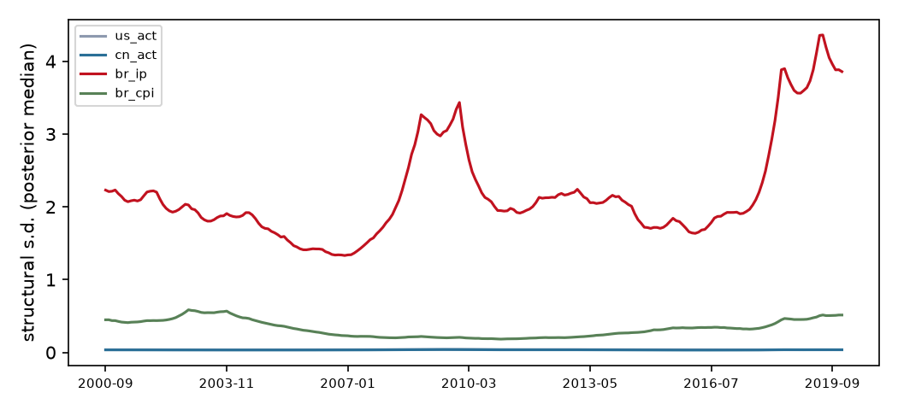

# How Brazil's response to foreign shocks changed as China replaced the United States

Prepared 2026-10-14 with `csuf-fullerton` (change 0005). Every number below comes from the
commands in section 9, run on `data/brazil.csv` and `data/brazil_trade.csv`; the full machine
output is in `outputs/`. `make brazil-check` rebuilds it and compares.

## 1. Answer first

- **Brazil's output now responds far more to China.** With 2019 trade weights, a one standard
  deviation shock to Chinese activity raises Brazilian industrial production by **1.80%** at its
  peak (month 9). With 2000 weights the peak is **0.69%** (month 16). The 2019 minus 2000
  difference is **+1.93 points at month 8**, with a 68% band of [1.92, 2.70] that excludes zero.
  The same pattern holds at 2, 4 and 6 lags (peaks 1.45, 1.80 and 1.89 at 2019 weights).
- **The time variation is real, not assumed.** Letting transmission depend on trade weights
  improves the fit: bootstrap LR p = **0.005** at p = 4 (0.015 at p = 2, 0.020 at p = 6). A
  constant-coefficient model also fails stability tests: Chow at 2009-01, bootstrap p = 0.010;
  sup-LR over all dates, bootstrap p = 0.005, strongest break 2004-03.
- **The U.S. effect did not fall the way the trade share did.** The U.S. share fell from 22%
  to 14%, but Brazil's peak response to U.S. activity is about the same (0.53% with 2000
  weights, 0.77% with 2019) and only fades faster after a year. That matches Cesa-Bianchi et
  al. (2012), who found the U.S. effect on Latin America works through more than bilateral trade.
- **The foreign block is exogenous, at enough lags.** Domestic variables do not Granger-cause
  the foreign block on the inflation-targeting sample: bootstrap lag-augmented Wald p = 0.37 at
  p = 4 (BIC) and 0.26 at p = 6. At p = 2 the test rejects (p = 0.029), and that rejection
  comes from too few lags rather than real feedback (section 4).
- **Robustness is mixed, and the report says where.** The kernel estimator (M2) agrees on the
  direction for China (correlation of Brazil's loading on China with China's weight +0.44), not
  for the U.S. The Bayesian TVP-VAR (M3) finds almost no drift in transmission and puts the
  change in volatility instead. Its tight priors are the likely reason (section 7).

## 2. The question and the data

China passed the United States as Brazil's largest trading partner in 2009. Three-year average
shares of Brazil's goods trade (exports plus imports, IMF IMTS):

| Year | United States | China |
|---|---|---|
| 2000 | 21.8% | 1.8% |
| 2009 | 15.8% | 8.5% |
| 2019 | 14.3% | 20.6% |

Weights for year *y* average years *y*-3 to *y*-1 (one-year lag), so they are fixed before the
year's shocks.

Monthly variables, all from FRED and the IMF (`examples/brazil/data.toml`):

| Block | Variable | Series |
|---|---|---|
| Foreign | `commodity` | IMF all-commodity price index, log x 100 |
| Foreign | `us_act` | U.S. activity: OECD GDP reference series, normalised cycle |
| Foreign | `cn_act` | China activity: the same OECD measure |
| Foreign | `ffr` | Federal funds rate |
| Domestic | `br_ip` | Brazil industrial production, SA, log x 100 |
| Domestic | `br_cpi` | Brazil CPI, NSA, log x 100 |
| Domestic | `br_selic` | Selic overnight rate |
| Domestic | `br_er` | Reais per U.S. dollar, log x 100 |

U.S. and China activity use the same OECD cycle measure so they can be combined with trade
weights; no source carries a quarterly real GDP index for China before 2011.

**Sample: 1999-07 to 2019-12.** Brazil floated the real in January 1999 and adopted inflation
targeting in June 1999. On the full 1996 to 2023 sample, every residual series rejects
normality (2020) and the screen's results are dominated by regime changes and COVID. The
sample through 2023-11 is reported as a robustness check (section 8).

## 3. Method in one paragraph

Four models, each tested against the one before. **M0** is the constant block-exogenous SVAR
of change 0002 with Chow and sup-LR stability tests. **M1** lets the domestic block load on U.S.
and China activity through their trade weights: an `interacted` model, in which each partner's
effect is linear in its weight (Towbin and Weber 2013), and a `star` model with GVAR loading
(Cesa-Bianchi et al. 2012). Impulse responses are computed with the weights held at 2000, 2009
and 2019 values, and differences between years are bootstrapped draw by draw. **M2** lets every
coefficient drift smoothly (kernel estimator, Giraitis, Kapetanios and Yates 2014). **M3** is
Primiceri's (2005) TVP-VAR with stochastic volatility on a four-variable system. Identification
is recursive with the foreign block first; foreign variables never respond to domestic shocks,
at any date, in any draw.

## 4. Before the VAR: exogeneity and lag order

The theory file (`examples/brazil/theory.toml`) puts commodity prices, U.S. and China activity
and the federal funds rate in the foreign block, with China activity flagged as the weakest
claim, since Brazil supplies much of China's soybeans and iron ore.

**Integration and cointegration.** Every variable except U.S. activity is I(1) on ADF and
KPSS. Johansen trace: cointegrating rank 1 of 8.

**Block exogeneity, by lag order** (bootstrap lag-augmented Wald, domestic lags excluded from
the foreign equations):

| Lags | Selected by | Bootstrap p | Holm p | Verdict |
|---|---|---|---|---|
| 2 | none | 0.029 | 0.040 | rejected |
| 4 | BIC | **0.370** | 0.792 | holds (mixed: federal funds rate not weakly exogenous) |
| 6 | AIC | 0.263 | 0.533 | holds (mixed, same reason) |

HQ picks 5. The rejection at p = 2 comes from too few lags: residual autocorrelation leaks
into the Granger tests. Everything below uses p = 4, with p = 2 and p = 6 as robustness.

**What the data cannot test.** Granger tests cover lags only. That the foreign block does not
react to Brazilian shocks within the month is an identifying assumption. The residual causal
order (DirectLiNGAM, advisory) puts China activity first and agrees with the foreign-first split
for 81% of foreign-domestic pairs.

**Remaining weakness.** The multivariate portmanteau test rejects at p = 4 (p < 0.001, h = 12),
so some serial correlation is left, likely from the seasonal CPI and the 2008 to 2009 crisis.

## 5. Is the time variation real? (M0 and M1 tests)

| Test | Statistic | df | Bootstrap p |
|---|---|---|---|
| M0: Chow at 2009-01, domestic block | 491.7 | 196 | **0.010** |
| M0: sup-LR over all dates (strongest at 2004-03) | 758.8 | 196 | **0.005** |
| M1: weights do not change transmission | 91.8 | 40 | **0.005** |
| M1: GVAR star loading is enough | 104.5 | 60 | 0.070 |

Bootstrap p-values regenerate data under the null and re-estimate on every draw; chi-square
p-values over-reject with persistent regressors and are in `outputs/`. The star test is
borderline, so a single shared slope comes close to explaining the change. Both variants are
reported.

## 6. Headline responses (M1, interacted, p = 4)

Response of Brazilian industrial production (%), 68% Hall bands, 1,000 bootstrap draws:

| Shock | Month | 2000 weights | 2009 weights | 2019 weights | 2019 minus 2000 |
|---|---|---|---|---|---|
| China activity | 0 | +0.05 | +0.16 | +0.36 | +0.31 [0.09, 0.60] |
| China activity | 6 | -0.30 | +0.38 | +1.31 | +1.61 [1.54, 2.20] |
| China activity | 12 | +0.45 | +0.75 | +1.37 | +0.92 [0.87, 1.76] |
| U.S. activity | 0 | -0.17 | +0.13 | +0.22 | +0.39 [0.27, 0.56] |
| U.S. activity | 6 | +0.42 | +0.46 | +0.64 | +0.22 [0.01, 0.41] |
| U.S. activity | 12 | +0.37 | +0.09 | +0.16 | -0.21 [-0.50, 0.06] |





**Brazilian prices** respond to China differently: at 2000 weights CPI rises after a Chinese
activity shock (+0.65 at month 12, the commodity-price channel); at 2019 weights it falls
(-0.33). One reading: the real now appreciates within a year of a Chinese boom (exchange rate
-2.35 at month 12 with 2019 weights), which lowers import prices. This is an interpretation,
not a test result.

**Reading the bands.** Hall intervals correct for small-sample bias by reflecting the bootstrap
quantiles around the estimate. In a few cells the band sits slightly to one side of the point
estimate (2019, month 12: +1.37 against [1.41, 2.15]), a sign of large bias in levels VARs of
this size. A bias-corrected bootstrap (Kilian 1998) is the next step if these numbers go into a
thesis.

## 7. Robustness

**Lag order.** Peak response of Brazil IP to China at 2019 weights: 1.45 (p = 2), 1.80 (p = 4),
1.89 (p = 6), against 0.55, 0.69 and 0.44 at 2000 weights. The time-variation LR test rejects
at all three (bootstrap p 0.015, 0.005, 0.020).

**Cesa-Bianchi et al. (2012) direction**, on their sample end (2009-12), 1995 against 2009
weights, mean over months 0 to 24: China effect **+0.56**, U.S. effect **-0.10**. Same direction
as the paper. At p = 2 the China change is positive over months 0 to 12 and slightly negative
over months 12 to 24, so the long-horizon part depends on lags.

**M2, kernel estimator** (bandwidth 47 months, p = 2). Brazil's local impact loading on China
activity rises with China's weight (correlation +0.44). The loading on U.S. activity moves
against the U.S. weight (correlation -0.88): it becomes less negative as the U.S. share falls.
So the drift supports the China story and says the U.S. change is not a trade-share effect.



**M3, TVP-VAR with stochastic volatility** (U.S. and China activity, Brazil IP and CPI as
12-month changes, p = 2, 10,000 draws). Responses barely move between 2002, 2009 and 2019: the
peak response of IP growth to China activity is 0.44, 0.46 and 0.32 at month 12, with
overlapping bands. The change shows up in volatility instead: Brazil IP shocks are largest in
late 2009 and 2018 to 2019. Primiceri's priors allow very little coefficient drift
(`k_Q = 0.01`), and with no pre-1999 training sample they are centred on full-sample OLS. M3 is
therefore conservative by construction. Convergence is adequate but not clean: maximum
Geweke |z| is 4.3 for the coefficient block.



## 8. Sample through 2023-11

Adding 2020 to 2023 breaks M1: impact loadings jump to implausible values (impact of a China
shock +16.6 with 2000 weights) because the 2020 collapse dominates a regression with
interaction terms. The tests still reject constant transmission (bootstrap p = 0.005), but the
responses are not usable. A COVID dummy set or a sample end in 2019 is required; the report uses
the latter.

## 9. Reproduce

```
make brazil-check                                     # rebuild everything and compare
bash scripts/reproduce_brazil.sh results/brazil       # rebuild only
FETCH=1 bash scripts/reproduce_brazil.sh              # re-download data first (numbers may move)
csuf-fullerton replicate --suite fast                 # the estimator checks behind these results
```

Step-by-step commands are in `QUICKSTART.md`, section 3. Before any number here was produced,
the replication suite checked each estimator. The fast suite passed 13 of 13 cases:
- statsmodels parity to 1e-8
- recovery of simulated time-varying transmission
- Primiceri's 1980 volatility peak
- the Cesa-Bianchi direction

## 10. Limits

- Trade weights respond to the same shocks the model studies; lagging and smoothing them
  reduces the problem, it does not remove it.
- OECD activity cycles are detrended indices; a "shock to China activity" is a one standard
  deviation move in that cycle, not in GDP growth.
- The federal funds rate fails weak exogeneity (it loads on the cointegrating relation), so the
  foreign block is "mixed" on statistics, as in the Nicaragua screen.
- Residual autocorrelation remains at p = 4 (portmanteau p < 0.001).
- The M3 prior is data-dependent; a pre-1999 training sample would come from a different
  monetary regime.

## References

- Cesa-Bianchi, A., Pesaran, M. H., Rebucci, A. and Xu, T. (2012), "China's emergence in the
  world economy and business cycles in Latin America," *Economía* 12(2). IZA DP 5889,
  https://docs.iza.org/dp5889.pdf
- Cushman, D. O. and Zha, T. (1997), *Journal of Monetary Economics* 39(3): 433-448.
- Del Negro, M. and Primiceri, G. E. (2015), *Review of Economic Studies* 82(4): 1342-1345.
- Giraitis, L., Kapetanios, G. and Yates, T. (2014), *Journal of Econometrics* 179(1): 46-65.
- Kilian, L. (1998), *Review of Economics and Statistics* 80(2): 218-230.
- Primiceri, G. E. (2005), *Review of Economic Studies* 72(3): 821-852.
- Towbin, P. and Weber, S. (2013), *Journal of Development Economics* 101: 179-194.
- Literature review and statsmodels assessment: `context-lake/2026-10-14-time-varying-var-literature.md`.
