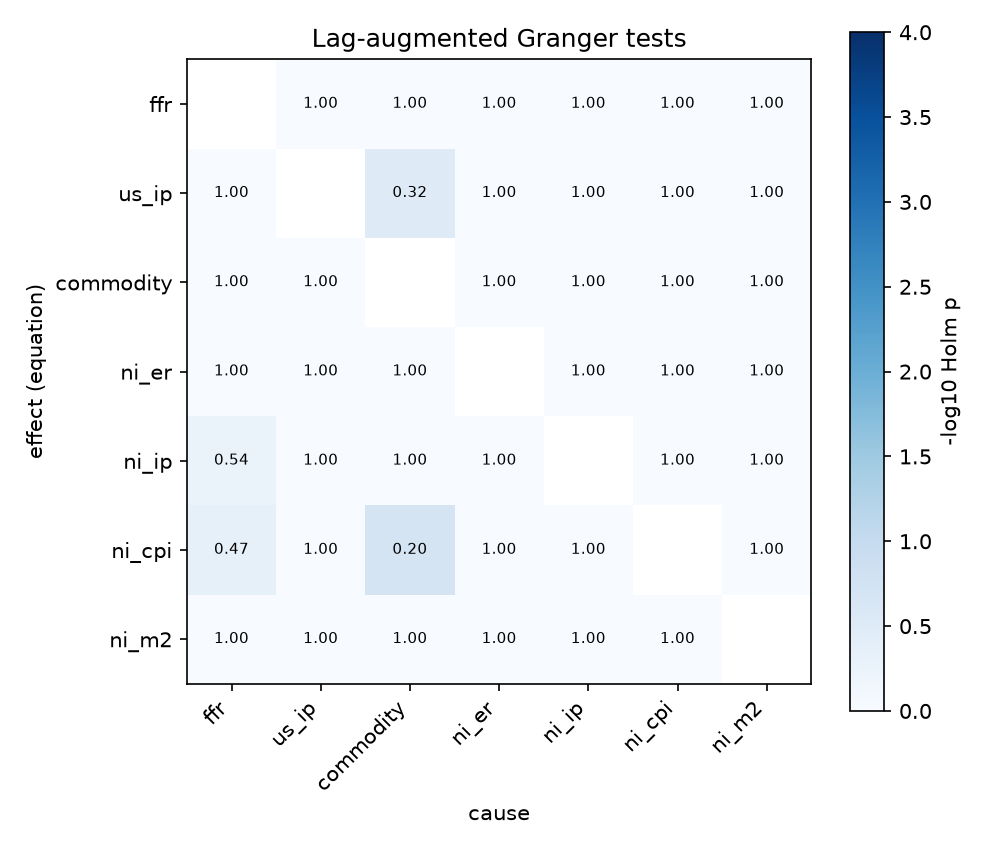
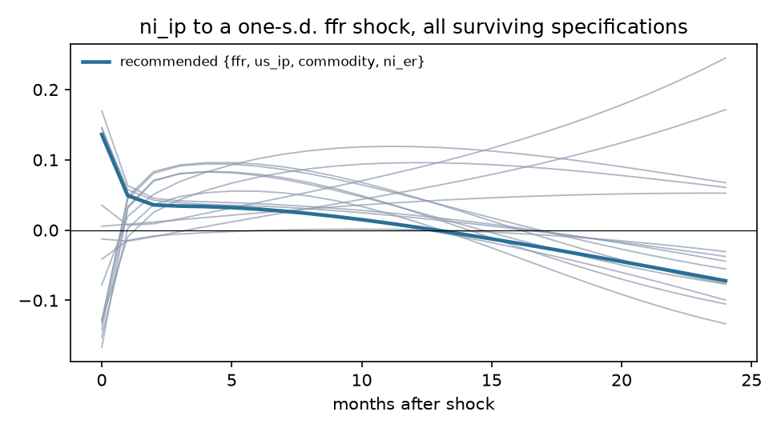
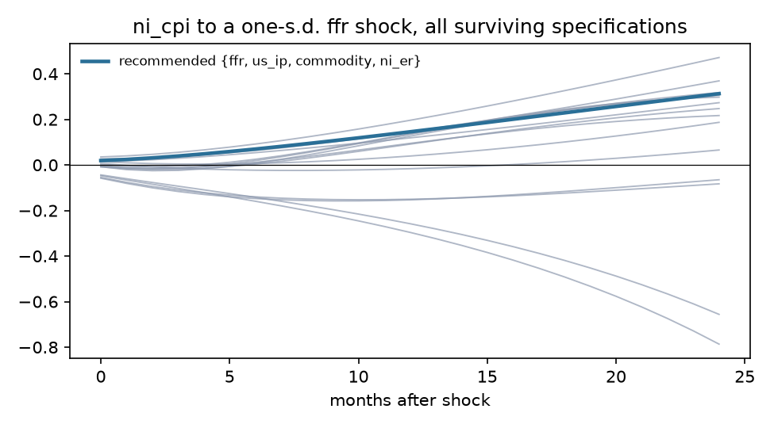
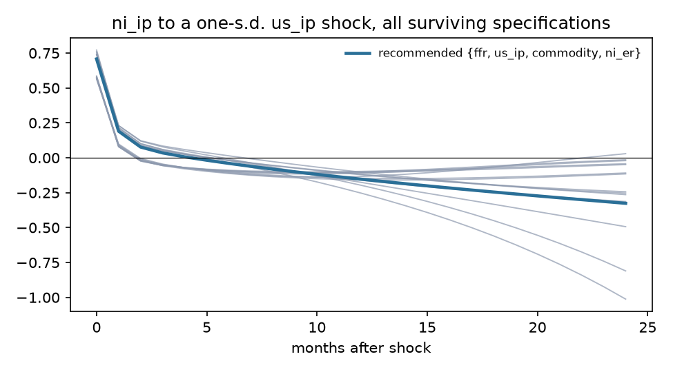
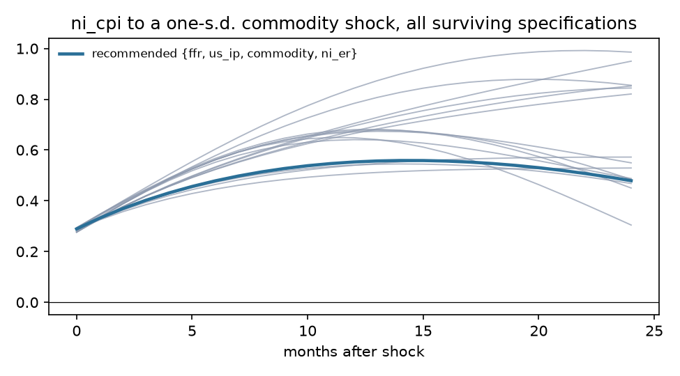

# Exogeneity screen: Nicaragua

Sample 2002-03 to 2014-06, 148 effective observations, 7 variables, lag order p = 1 (AIC 4, BIC 1, HQ 1), lag augmentation d_max = 2. Deterministic terms: constant, trend, seasonal dummies.

## Recommendation

**Foreign block {ffr, us_ip, commodity, ni_er}**, domestic block {ni_ip, ni_cpi, ni_m2}. Theory grade A (all exogenous variables foreign; candidates added: ni_er); statistical verdict **mixed** (lag restriction holds but not weakly exogenous: us_ip).

Runner-up: {ffr, us_ip, commodity}, grade A, verdict mixed, BIC -2.727 against -2.788.

## Stage 1. Integration order

| Variable | Order | ADF p (level) | KPSS p (level) | ADF p (diff) | KPSS p (diff) | Conflict |
|---|---|---|---|---|---|---|
| ffr | I(2) | 0.050 | 0.010 | 0.351 | 0.100 | yes |
| us_ip | I(1) | 0.246 | 0.035 | 0.047 | 0.100 |  |
| commodity | I(1) | 0.315 | 0.010 | <0.001 | 0.100 |  |
| ni_er | I(2) | <0.001 | 0.010 | 0.166 | 0.010 | yes |
| ni_ip | I(1) | 0.584 | 0.100 | <0.001 | 0.100 | yes |
| ni_cpi | I(1) | 0.664 | 0.010 | <0.001 | 0.100 |  |
| ni_m2 | I(1) | 0.907 | 0.010 | <0.001 | 0.100 |  |

Johansen trace test: cointegrating rank 4 of 7 at 5%. Weak exogeneity tests are run on the foreign block.

## Stage 3. Pairwise evidence

Lag-augmented (Toda-Yamamoto) Granger p-values, conditional on the whole system, unadjusted. Row is the equation (effect), column the cause. Bold marks pairs that stay below 0.05 after Holm adjustment across all 42 pairs.

| effect \ cause | ffr | us_ip | commodity | ni_er | ni_ip | ni_cpi | ni_m2 |
|---|---|---|---|---|---|---|---|
| ffr |  | 0.105 | 0.484 | 0.130 | 0.168 | 0.548 | 0.972 |
| us_ip | 0.272 |  | 0.008 | 0.483 | 0.770 | 0.288 | 0.048 |
| commodity | 0.911 | 0.428 |  | 0.282 | 0.130 | 0.810 | 0.755 |
| ni_er | 0.375 | 0.868 | 0.164 |  | 0.987 | 0.212 | 0.771 |
| ni_ip | 0.014 | 0.807 | 0.329 | 0.211 |  | 0.893 | 0.547 |
| ni_cpi | 0.012 | 0.600 | 0.005 | 0.689 | 0.429 |  | 0.941 |
| ni_m2 | 0.381 | 0.109 | 0.232 | 0.678 | 0.937 | 0.703 |  |

DirectLiNGAM causal order of the reduced-form residuals (advisory; needs non-Gaussian residuals, 86% of series reject normality): **ni_er > commodity > ni_ip > ni_m2 > us_ip > ni_cpi > ffr**.

| Pair | Pairwise direction | R |
|---|---|---|
| ffr, ni_ip | ni_ip -> ffr | -0.0010 |
| ffr, ni_cpi | ni_cpi -> ffr | -0.0006 |
| us_ip, ni_ip | ni_ip -> us_ip | -0.0033 |
| us_ip, ni_cpi | us_ip -> ni_cpi | +0.0015 |
| commodity, ni_ip | commodity -> ni_ip | +0.0005 |
| commodity, ni_cpi | commodity -> ni_cpi | +0.0068 |
| ni_er, ni_ip | ni_er -> ni_ip | +0.0012 |
| ni_er, ni_cpi | ni_er -> ni_cpi | +0.0021 |

## Stage 4 and 5. Candidate specifications

LA-Wald is the primary test (domestic lags excluded from foreign equations, robust to unit roots); its p-value is bootstrapped under the null (Hacker and Hatemi-J 2006) because the asymptotic version over-rejects in samples this size. Holm p adjusts the bootstrap p across every admissible candidate. LR is the Sims-corrected likelihood ratio of change 0002. Inst. p tests residual correlation between blocks (rejection is expected and is what the recursive impact matrix orders). CW is the Clark-West out-of-sample test that domestic lags improve foreign forecasts. LiNGAM agree is the share of foreign-domestic pairs the data-driven causal order puts foreign first, with the bootstrap 5th percentile.

| Rank | Foreign block | Theory | Verdict | LA-Wald asym. p | LA-Wald boot p | Holm p | LR p | Inst. p | Not weakly exog. | CW Holm p | BIC | LiNGAM agree (5%) | Max root |
|---|---|---|---|---|---|---|---|---|---|---|---|---|---|
| 1 | {ffr, us_ip, commodity, ni_er} | A | mixed | 0.458 | 0.547 | 1.000 | <0.001 | <0.001 | us_ip | <0.001 | -2.788 | 0.58 (0.25) | 1.011 |
| 2 | {ffr, us_ip, commodity} | A | mixed | 0.253 | 0.325 | 1.000 | <0.001 | <0.001 | ffr, us_ip | 0.003 | -2.727 | 0.33 (0.08) | 1.007 |
| 3 | {commodity} | B | supported | 0.590 | 0.632 | 1.000 | 0.023 | <0.001 | none | 0.994 | -3.637 | 0.83 (0.00) | 0.965 |
| 4 | {commodity, ni_er} | B | supported | 0.831 | 0.838 | 1.000 | 0.008 | <0.001 | none | 0.002 | -3.566 | 1.00 (0.20) | 0.967 |
| 5 | {ffr} | B | supported | 0.284 | 0.312 | 1.000 | <0.001 | <0.001 | none | <0.001 | -3.249 | 0.00 (0.00) | 0.993 |
| 6 | {ffr, commodity} | B | supported | 0.316 | 0.347 | 1.000 | <0.001 | <0.001 | none | 0.044 | -3.231 | 0.40 (0.10) | 0.974 |
| 7 | {ffr, ni_er} | B | supported | 0.712 | 0.733 | 1.000 | <0.001 | 0.005 | none | <0.001 | -3.189 | 0.50 (0.20) | 0.991 |
| 8 | {ni_er} | B | mixed | 0.821 | 0.811 | 1.000 | 0.014 | 0.086 | ni_er | <0.001 | -3.626 | 1.00 (0.33) | 0.970 |
| 9 | {ffr, commodity, ni_er} | B | mixed | 0.619 | 0.642 | 1.000 | <0.001 | <0.001 | ni_er | <0.001 | -3.262 | 0.67 (0.25) | 0.973 |
| 10 | {us_ip} | B | mixed | 0.067 | 0.092 | 1.000 | <0.001 | 0.005 | us_ip | 0.006 | -3.201 | 0.33 (0.00) | 1.034 |
| 11 | {us_ip, commodity} | B | mixed | 0.390 | 0.438 | 1.000 | <0.001 | <0.001 | us_ip | 0.063 | -3.134 | 0.60 (0.10) | 1.076 |
| 12 | {us_ip, ni_er} | B | mixed | 0.151 | 0.162 | 1.000 | <0.001 | 0.001 | us_ip | <0.001 | -3.091 | 0.70 (0.40) | 1.035 |
| 13 | {us_ip, commodity, ni_er} | B | mixed | 0.526 | 0.571 | 1.000 | <0.001 | <0.001 | us_ip, ni_er | <0.001 | -3.063 | 0.83 (0.33) | 1.072 |
| 14 | {ffr, us_ip} | B | mixed | 0.089 | 0.132 | 1.000 | <0.001 | <0.001 | ffr, us_ip | <0.001 | -2.717 | 0.10 (0.10) | 1.005 |
| 15 | {ffr, us_ip, ni_er} | B | mixed | 0.208 | 0.237 | 1.000 | <0.001 | 0.009 | ffr, us_ip, ni_er | <0.001 | -2.693 | 0.42 (0.25) | 1.014 |

## Stage 6. Robustness of headline responses

- **ni_ip to a ffr shock**: recommended specification peaks at +0.1361 at horizon 0; 6 of 15 surviving specifications and orderings have the same sign there.

- **ni_cpi to a ffr shock**: recommended specification peaks at +0.3129 at horizon 24; 11 of 15 surviving specifications and orderings have the same sign there.

- **ni_ip to a us_ip shock**: recommended specification peaks at +0.7079 at horizon 0; 15 of 15 surviving specifications and orderings have the same sign there.

- **ni_cpi to a commodity shock**: recommended specification peaks at +0.5587 at horizon 14; 15 of 15 surviving specifications and orderings have the same sign there.

## Theory file

| Variable | Prior | Rationale | Source |
|---|---|---|---|
| ffr | exogenous | U.S. policy rate. Nicaragua's GDP is roughly 0.06% of U.S. GDP; the FOMC does not react to it. | Cushman and Zha (1997); Maćkowiak (2007) |
| us_ip | exogenous | U.S. activity is Nicaragua's main export demand; no plausible feedback from Nicaraguan output. | Cushman and Zha (1997); Maćkowiak (2007) |
| commodity | exogenous | World commodity prices; Nicaragua is a price taker in coffee, beef, gold and oil. | Kim and Roubini (2000); Maćkowiak (2007) |
| ni_er | candidate | Cordoba per dollar under a pre-announced crawling peg (5% a year over this sample). The path is set by rule, so it may be predetermined with respect to monthly domestic shocks. | Banco Central de Nicaragua exchange-rate regime; Calvo and Reinhart (2002) on pegs |
| ni_ip | endogenous | Domestic activity. |  |
| ni_cpi | endogenous | Domestic prices. |  |
| ni_m2 | endogenous | Broad money; under a peg it adjusts endogenously to money demand and reserves. | Obstfeld and Rogoff (1995) on money under fixed exchange rates |
