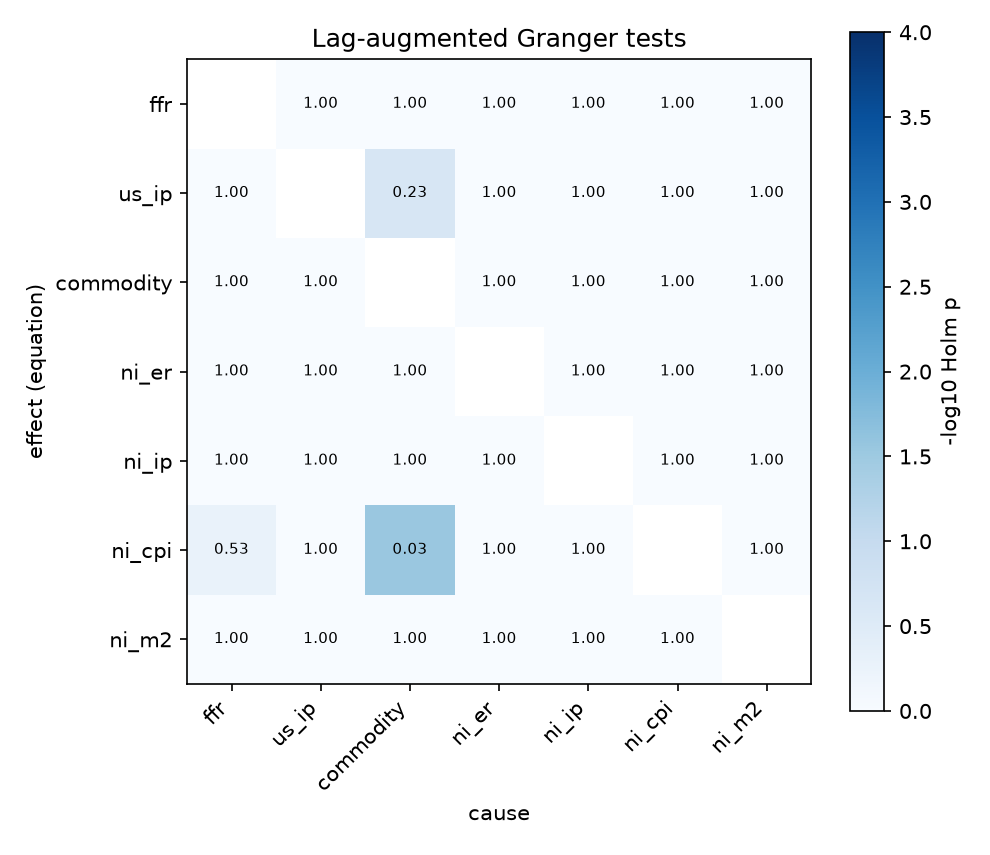
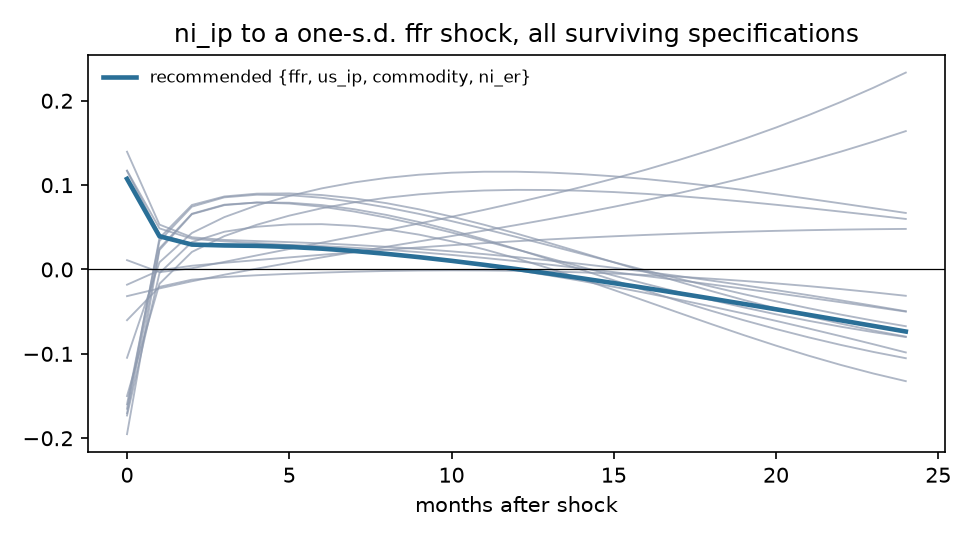
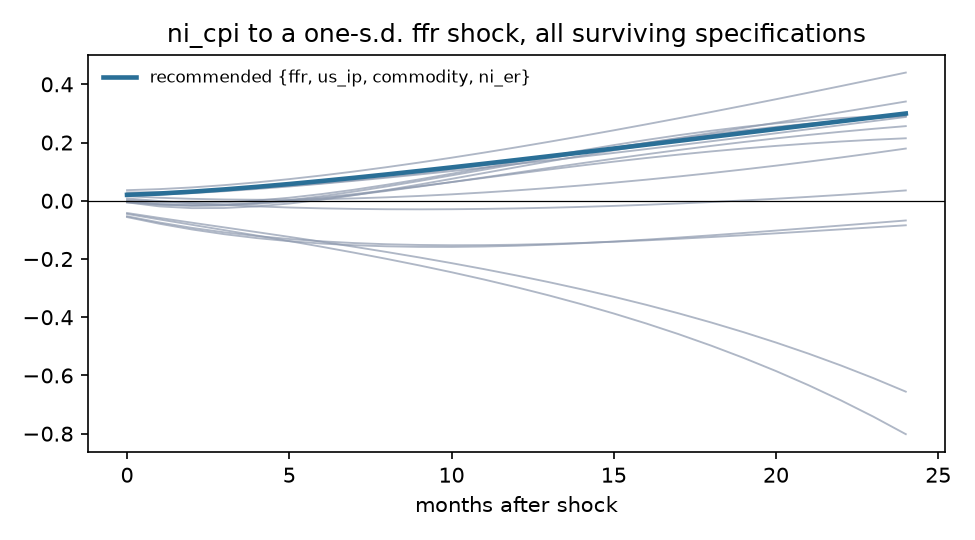
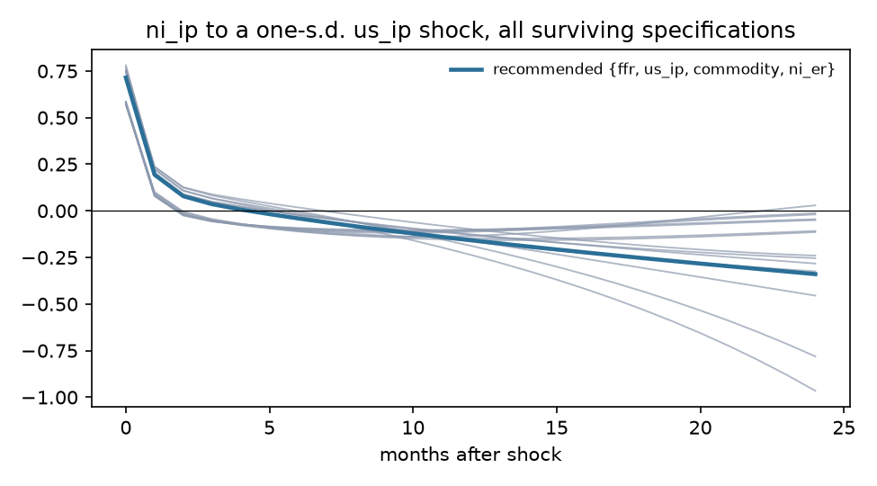
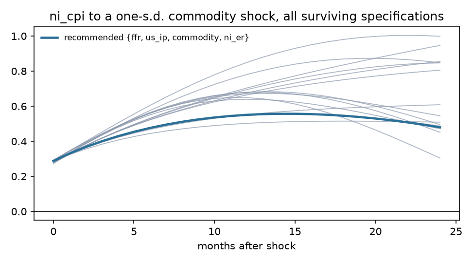

# Exogeneity screen: Nicaragua

Sample 2002-02 to 2014-06, 149 effective observations, 7 variables, lag order p = 1 (AIC 4, BIC 1, HQ 1), lag augmentation d_max = 1. Deterministic terms: constant, trend, seasonal dummies.

## Recommendation

**Foreign block {ffr, us_ip, commodity, ni_er}**, domestic block {ni_ip, ni_cpi, ni_m2}. Theory grade A (all exogenous variables foreign; candidates added: ni_er); statistical verdict **mixed** (lag restriction holds but not weakly exogenous: us_ip).

Runner-up: {ffr, us_ip, commodity}, grade A, verdict mixed, BIC -2.761 against -2.812.

## Stage 1. Integration order

| Variable | Order | ADF p (level) | KPSS p (level) | ADF p (diff) | KPSS p (diff) | Conflict |
|---|---|---|---|---|---|---|
| ffr | I(2) | 0.050 | 0.010 | 0.351 | 0.100 | yes |
| us_ip | I(1) | 0.246 | 0.035 | 0.047 | 0.100 |  |
| commodity | I(1) | 0.315 | 0.010 | <0.001 | 0.100 |  |
| ni_er | I(2) | <0.001 | 0.010 | 0.166 | 0.010 | yes |
| ni_ip | I(1) | 0.584 | 0.100 | <0.001 | 0.100 | yes |
| ni_cpi | I(1) | 0.664 | 0.010 | <0.001 | 0.100 |  |
| ni_m2 | I(1) | 0.907 | 0.010 | <0.001 | 0.100 |  |

Johansen trace test: cointegrating rank 4 of 7 at 5%. Weak exogeneity tests are run on the foreign block.

## Stage 3. Pairwise evidence

Lag-augmented (Toda-Yamamoto) Granger p-values, conditional on the whole system, unadjusted. Row is the equation (effect), column the cause. Bold marks pairs that stay below 0.05 after Holm adjustment across all 42 pairs.

| effect \ cause | ffr | us_ip | commodity | ni_er | ni_ip | ni_cpi | ni_m2 |
|---|---|---|---|---|---|---|---|
| ffr |  | 0.128 | 0.746 | 0.086 | 0.058 | 0.810 | 0.846 |
| us_ip | 0.293 |  | 0.006 | 0.466 | 0.736 | 0.722 | 0.068 |
| commodity | 0.428 | 0.221 |  | 0.278 | 0.295 | 0.953 | 0.697 |
| ni_er | 0.039 | 0.404 | 0.635 |  | 0.531 | 0.283 | 0.719 |
| ni_ip | 0.326 | 0.775 | 0.463 | 0.165 |  | 0.599 | 0.763 |
| ni_cpi | 0.013 | 0.464 | **<0.001** | 0.637 | 0.617 |  | 0.780 |
| ni_m2 | 0.932 | 0.079 | 0.101 | 0.522 | 0.987 | 0.337 |  |

DirectLiNGAM causal order of the reduced-form residuals (advisory; needs non-Gaussian residuals, 86% of series reject normality): **ni_ip > ni_er > commodity > ni_m2 > us_ip > ni_cpi > ffr**.

| Pair | Pairwise direction | R |
|---|---|---|
| ffr, ni_ip | ni_ip -> ffr | -0.0012 |
| ffr, ni_cpi | ni_cpi -> ffr | -0.0004 |
| us_ip, ni_ip | ni_ip -> us_ip | -0.0034 |
| us_ip, ni_cpi | us_ip -> ni_cpi | +0.0015 |
| commodity, ni_ip | commodity -> ni_ip | +0.0005 |
| commodity, ni_cpi | commodity -> ni_cpi | +0.0068 |
| ni_er, ni_ip | ni_er -> ni_ip | +0.0010 |
| ni_er, ni_cpi | ni_er -> ni_cpi | +0.0020 |

## Stage 4 and 5. Candidate specifications

LA-Wald is the primary test (domestic lags excluded from foreign equations, robust to unit roots); its p-value is bootstrapped under the null (Hacker and Hatemi-J 2006) because the asymptotic version over-rejects in samples this size. Holm p adjusts the bootstrap p across every admissible candidate. LR is the Sims-corrected likelihood ratio of change 0002. Inst. p tests residual correlation between blocks (rejection is expected and is what the recursive impact matrix orders). CW is the Clark-West out-of-sample test that domestic lags improve foreign forecasts. LiNGAM agree is the share of foreign-domestic pairs the data-driven causal order puts foreign first, with the bootstrap 5th percentile.

| Rank | Foreign block | Theory | Verdict | LA-Wald asym. p | LA-Wald boot p | Holm p | LR p | Inst. p | Not weakly exog. | CW Holm p | BIC | LiNGAM agree (5%) | Max root |
|---|---|---|---|---|---|---|---|---|---|---|---|---|---|
| 1 | {ffr, us_ip, commodity, ni_er} | A | mixed | 0.549 | 0.593 | 1.000 | <0.001 | <0.001 | us_ip | <0.001 | -2.812 | 0.42 (0.33) | 1.011 |
| 2 | {ffr, us_ip, commodity} | A | mixed | 0.252 | 0.296 | 1.000 | <0.001 | <0.001 | ffr, us_ip | 0.002 | -2.761 | 0.25 (0.17) | 1.007 |
| 3 | {commodity} | B | supported | 0.541 | 0.572 | 1.000 | 0.021 | <0.001 | none | 0.996 | -3.663 | 0.67 (0.00) | 0.968 |
| 4 | {commodity, ni_er} | B | supported | 0.446 | 0.482 | 1.000 | 0.006 | <0.001 | none | 0.002 | -3.587 | 0.80 (0.30) | 0.969 |
| 5 | {ffr} | B | supported | 0.177 | 0.203 | 1.000 | <0.001 | <0.001 | none | <0.001 | -3.285 | 0.00 (0.00) | 0.993 |
| 6 | {ffr, commodity} | B | supported | 0.229 | 0.259 | 1.000 | <0.001 | <0.001 | none | 0.022 | -3.266 | 0.30 (0.10) | 0.975 |
| 7 | {ffr, ni_er} | B | supported | 0.653 | 0.672 | 1.000 | <0.001 | 0.004 | none | <0.001 | -3.217 | 0.40 (0.20) | 0.991 |
| 8 | {ni_er} | B | mixed | 0.386 | 0.397 | 1.000 | 0.009 | 0.055 | ni_er | <0.001 | -3.647 | 0.83 (0.17) | 0.971 |
| 9 | {ffr, commodity, ni_er} | B | mixed | 0.520 | 0.541 | 1.000 | <0.001 | <0.001 | ni_er | <0.001 | -3.288 | 0.50 (0.33) | 0.972 |
| 10 | {us_ip} | B | mixed | 0.033 | 0.050 | 0.700 | <0.001 | 0.005 | us_ip | 0.004 | -3.229 | 0.33 (0.00) | 1.032 |
| 11 | {us_ip, commodity} | B | mixed | 0.620 | 0.657 | 1.000 | <0.001 | <0.001 | us_ip | 0.039 | -3.160 | 0.50 (0.10) | 1.077 |
| 12 | {us_ip, ni_er} | B | mixed | 0.036 | 0.076 | 0.986 | <0.001 | <0.001 | us_ip | <0.001 | -3.111 | 0.60 (0.30) | 1.035 |
| 13 | {us_ip, commodity, ni_er} | B | mixed | 0.451 | 0.510 | 1.000 | <0.001 | <0.001 | us_ip, ni_er | <0.001 | -3.084 | 0.67 (0.33) | 1.072 |
| 14 | {ffr, us_ip} | B | mixed | 0.021 | 0.031 | 0.463 | <0.001 | <0.001 | ffr, us_ip | <0.001 | -2.753 | 0.10 (0.10) | 1.000 |
| 15 | {ffr, us_ip, ni_er} | B | mixed | 0.102 | 0.155 | 1.000 | <0.001 | 0.008 | ffr, us_ip, ni_er | <0.001 | -2.718 | 0.33 (0.33) | 1.012 |

## Stage 6. Robustness of headline responses

- **ni_ip to a ffr shock**: recommended specification peaks at +0.1074 at horizon 0; 5 of 15 surviving specifications and orderings have the same sign there.

- **ni_cpi to a ffr shock**: recommended specification peaks at +0.2997 at horizon 24; 11 of 15 surviving specifications and orderings have the same sign there.

- **ni_ip to a us_ip shock**: recommended specification peaks at +0.7149 at horizon 0; 15 of 15 surviving specifications and orderings have the same sign there.

- **ni_cpi to a commodity shock**: recommended specification peaks at +0.5567 at horizon 15; 15 of 15 surviving specifications and orderings have the same sign there.

## Theory file

| Variable | Prior | Rationale | Source |
|---|---|---|---|
| ffr | exogenous | U.S. policy rate. Nicaragua's GDP is roughly 0.06% of U.S. GDP; the FOMC does not react to it. | Cushman and Zha (1997); Maćkowiak (2007) |
| us_ip | exogenous | U.S. activity is Nicaragua's main export demand; no plausible feedback from Nicaraguan output. | Cushman and Zha (1997); Maćkowiak (2007) |
| commodity | exogenous | World commodity prices; Nicaragua is a price taker in coffee, beef, gold and oil. | Kim and Roubini (2000); Maćkowiak (2007) |
| ni_er | candidate | Cordoba per dollar under a pre-announced crawling peg (5% a year over this sample). The path is set by rule, so it may be predetermined with respect to monthly domestic shocks. | Banco Central de Nicaragua exchange-rate regime; Calvo and Reinhart (2002) on pegs |
| ni_ip | endogenous | Domestic activity. |  |
| ni_cpi | endogenous | Domestic prices. |  |
| ni_m2 | endogenous | Broad money; under a peg it adjusts endogenously to money demand and reserves. | Obstfeld and Rogoff (1995) on money under fixed exchange rates |
