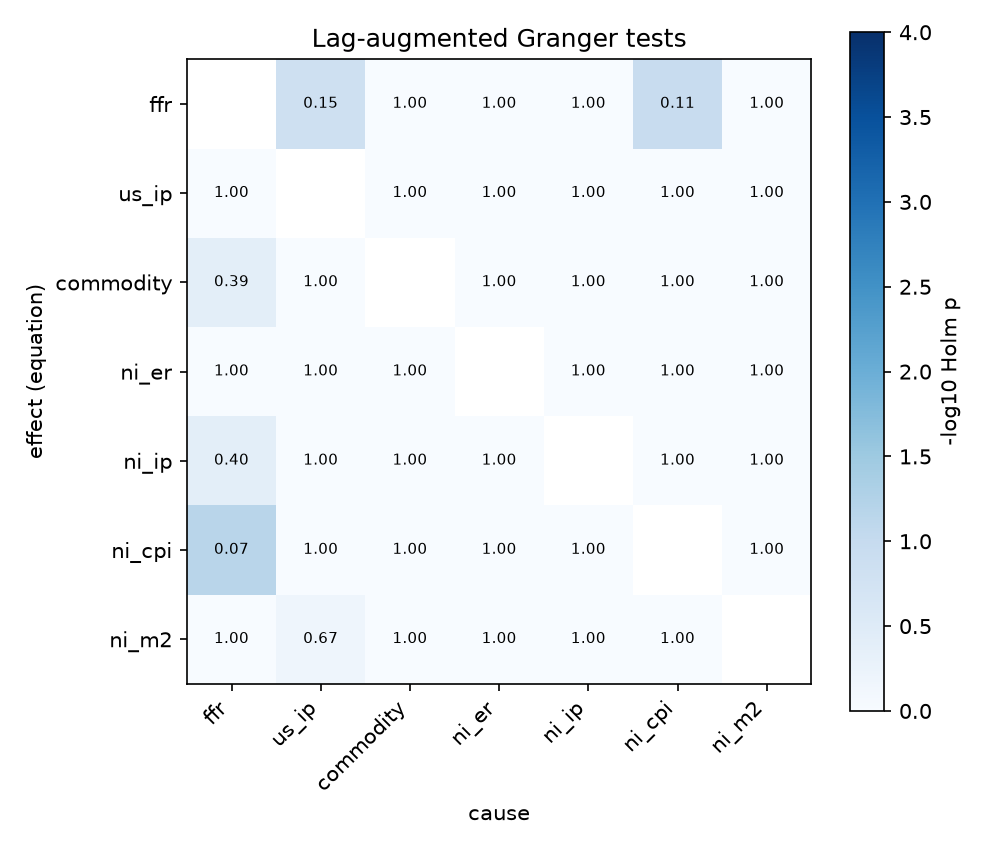
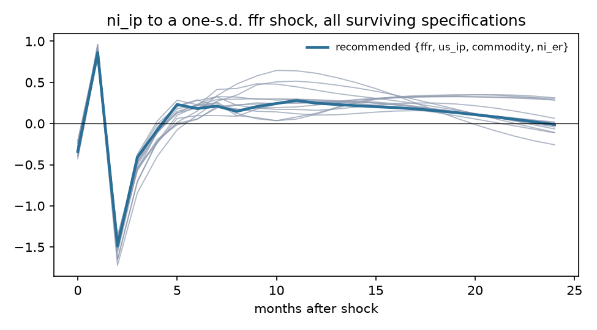
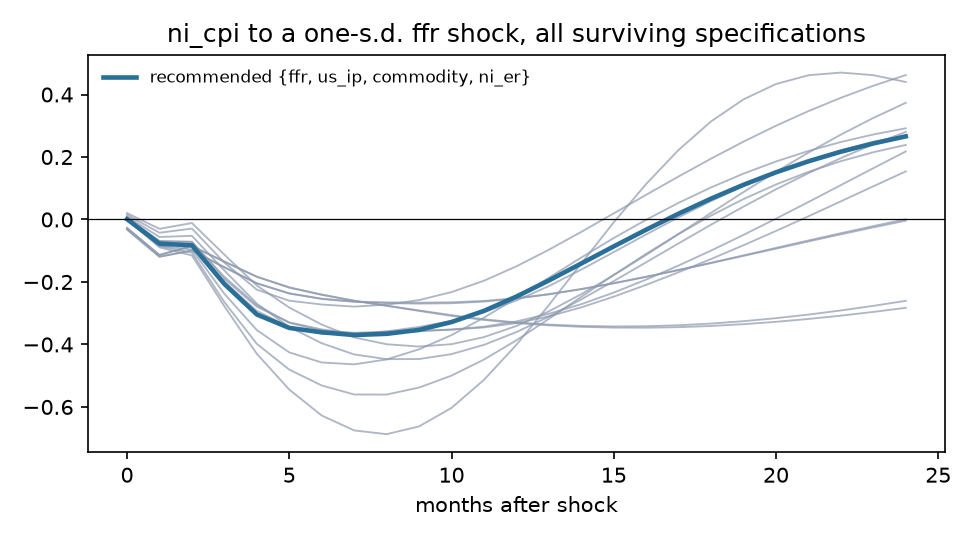
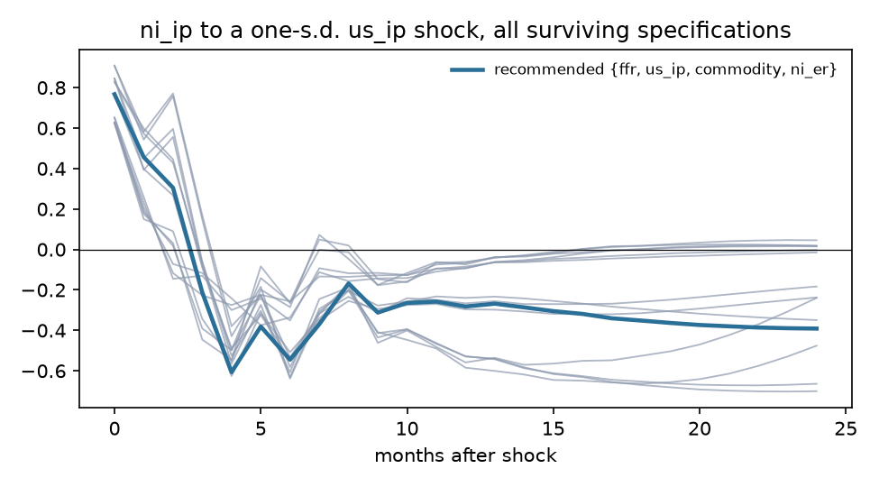
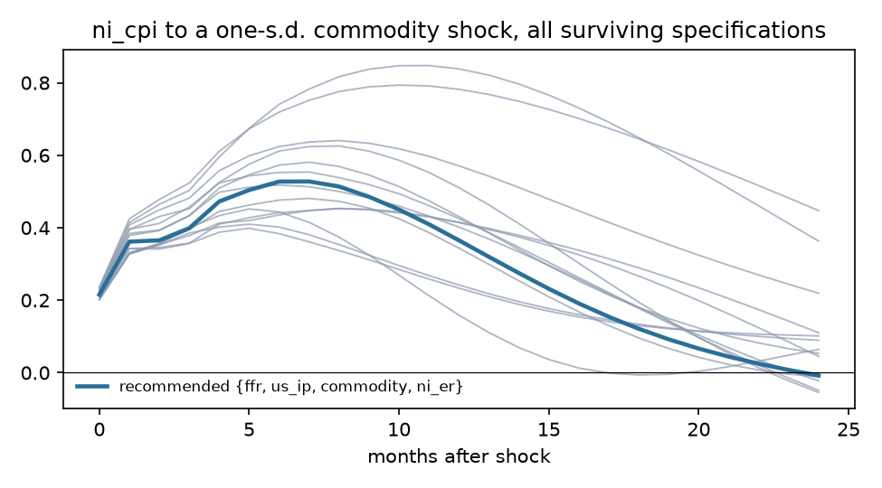

# Exogeneity screen: Nicaragua

Sample 2002-06 to 2014-06, 145 effective observations, 7 variables, lag order p = 4 (AIC 4, BIC 1, HQ 1), lag augmentation d_max = 2. Deterministic terms: constant, trend, seasonal dummies.

## Recommendation

**Foreign block {ffr, us_ip, commodity, ni_er}**, domestic block {ni_ip, ni_cpi, ni_m2}. Theory grade A (all exogenous variables foreign; candidates added: ni_er); statistical verdict **mixed** (lag restriction holds but not weakly exogenous: us_ip).

Runner-up: {ffr, us_ip, commodity}, grade A, verdict mixed, BIC -1.422 against -1.559.

## Stage 1. Integration order

| Variable | Order | ADF p (level) | KPSS p (level) | ADF p (diff) | KPSS p (diff) | Conflict |
|---|---|---|---|---|---|---|
| ffr | I(2) | 0.050 | 0.010 | 0.351 | 0.100 | yes |
| us_ip | I(1) | 0.246 | 0.035 | 0.047 | 0.100 |  |
| commodity | I(1) | 0.315 | 0.010 | <0.001 | 0.100 |  |
| ni_er | I(2) | <0.001 | 0.010 | 0.166 | 0.010 | yes |
| ni_ip | I(1) | 0.584 | 0.100 | <0.001 | 0.100 | yes |
| ni_cpi | I(1) | 0.664 | 0.010 | <0.001 | 0.100 |  |
| ni_m2 | I(1) | 0.907 | 0.010 | <0.001 | 0.100 |  |

Johansen trace test: cointegrating rank 4 of 7 at 5%. Weak exogeneity tests are run on the foreign block.

## Stage 3. Pairwise evidence

Lag-augmented (Toda-Yamamoto) Granger p-values, conditional on the whole system, unadjusted. Row is the equation (effect), column the cause. Bold marks pairs that stay below 0.05 after Holm adjustment across all 42 pairs.

| effect \ cause | ffr | us_ip | commodity | ni_er | ni_ip | ni_cpi | ni_m2 |
|---|---|---|---|---|---|---|---|
| ffr |  | 0.004 | 0.823 | 0.052 | 0.221 | 0.003 | 0.397 |
| us_ip | 0.848 |  | 0.094 | 0.882 | 0.579 | 0.079 | 0.136 |
| commodity | 0.010 | 0.699 |  | 0.599 | 0.893 | 0.848 | 0.719 |
| ni_er | 0.801 | 0.161 | 0.413 |  | 0.902 | 0.953 | 0.830 |
| ni_ip | 0.011 | 0.688 | 0.750 | 0.427 |  | 0.985 | 0.354 |
| ni_cpi | 0.002 | 0.226 | 0.135 | 0.798 | 0.489 |  | 0.999 |
| ni_m2 | 0.408 | 0.018 | 0.578 | 0.630 | 0.690 | 0.260 |  |

DirectLiNGAM causal order of the reduced-form residuals (advisory; needs non-Gaussian residuals, 57% of series reject normality): **ni_er > ni_m2 > us_ip > commodity > ni_cpi > ni_ip > ffr**.

| Pair | Pairwise direction | R |
|---|---|---|
| ffr, ni_cpi | ffr -> ni_cpi | +0.0002 |
| us_ip, ni_cpi | ni_cpi -> us_ip | -0.0018 |
| ni_er, ni_cpi | ni_er -> ni_cpi | +0.0076 |

## Stage 4 and 5. Candidate specifications

LA-Wald is the primary test (domestic lags excluded from foreign equations, robust to unit roots); its p-value is bootstrapped under the null (Hacker and Hatemi-J 2006) because the asymptotic version over-rejects in samples this size. Holm p adjusts the bootstrap p across every admissible candidate. LR is the Sims-corrected likelihood ratio of change 0002. Inst. p tests residual correlation between blocks (rejection is expected and is what the recursive impact matrix orders). CW is the Clark-West out-of-sample test that domestic lags improve foreign forecasts. LiNGAM agree is the share of foreign-domestic pairs the data-driven causal order puts foreign first, with the bootstrap 5th percentile.

| Rank | Foreign block | Theory | Verdict | LA-Wald asym. p | LA-Wald boot p | Holm p | LR p | Inst. p | Not weakly exog. | CW Holm p | BIC | LiNGAM agree (5%) | Max root |
|---|---|---|---|---|---|---|---|---|---|---|---|---|---|
| 1 | {ffr, us_ip, commodity, ni_er} | A | mixed | 0.251 | 0.406 | 1.000 | 0.015 | <0.001 | us_ip | 0.076 | -1.559 | 0.58 (0.17) | 0.977 |
| 2 | {ffr, us_ip, commodity} | A | mixed | 0.059 | 0.159 | 1.000 | <0.001 | <0.001 | us_ip | 0.089 | -1.422 | 0.33 (0.00) | 0.986 |
| 3 | {commodity, ni_er} | B | supported | 0.443 | 0.503 | 1.000 | 0.667 | <0.001 | none | 0.676 | -1.700 | 0.80 (0.40) | 0.970 |
| 4 | {ffr, commodity, ni_er} | B | supported | 0.085 | 0.162 | 1.000 | 0.157 | <0.001 | none | 0.961 | -1.693 | 0.50 (0.17) | 0.940 |
| 5 | {ni_er} | B | supported | 0.897 | 0.876 | 1.000 | 0.891 | 0.131 | none | 0.244 | -1.478 | 1.00 (0.50) | 0.963 |
| 6 | {us_ip, commodity, ni_er} | B | mixed | 0.562 | 0.669 | 1.000 | 0.019 | <0.001 | us_ip | 0.041 | -1.572 | 0.83 (0.33) | 0.985 |
| 7 | {ffr, ni_er} | B | mixed | 0.008 | 0.033 | 0.433 | 0.029 | 0.032 | none | 0.392 | -1.479 | 0.50 (0.29) | 0.957 |
| 8 | {ffr, commodity} | B | mixed | 0.007 | 0.039 | 0.470 | 0.011 | <0.001 | none | 1.000 | -1.436 | 0.20 (0.00) | 0.920 |
| 9 | {us_ip, ni_er} | B | mixed | 0.803 | 0.827 | 1.000 | 0.002 | 0.005 | us_ip | 0.016 | -1.357 | 0.90 (0.50) | 0.999 |
| 10 | {us_ip, commodity} | B | mixed | 0.406 | 0.524 | 1.000 | 0.002 | <0.001 | us_ip | <0.001 | -1.354 | 0.60 (0.00) | 0.984 |
| 11 | {commodity} | B | mixed | 0.288 | 0.359 | 1.000 | 0.163 | <0.001 | commodity | 0.944 | -1.336 | 0.50 (0.00) | 0.974 |
| 12 | {ffr, us_ip, ni_er} | B | mixed | 0.039 | 0.095 | 1.000 | <0.001 | 0.007 | us_ip | 0.011 | -1.297 | 0.58 (0.33) | 0.941 |
| 13 | {ffr, us_ip} | B | mixed | 0.006 | 0.031 | 0.432 | <0.001 | 0.025 | us_ip | 0.011 | -1.134 | 0.30 (0.10) | 0.967 |
| 14 | {us_ip} | B | mixed | 0.490 | 0.518 | 1.000 | <0.001 | 0.013 | us_ip | 0.019 | -1.071 | 0.67 (0.00) | 1.004 |
| 15 | {ffr} | B | rejected | <0.001 | 0.003 | 0.037 | 0.002 | 0.071 | none | 0.626 | -1.160 | 0.00 (0.00) | 0.965 |

## Stage 6. Robustness of headline responses

- **ni_ip to a ffr shock**: recommended specification peaks at -1.4881 at horizon 2; 14 of 14 surviving specifications and orderings have the same sign there.

- **ni_cpi to a ffr shock**: recommended specification peaks at -0.3699 at horizon 7; 14 of 14 surviving specifications and orderings have the same sign there.

- **ni_ip to a us_ip shock**: recommended specification peaks at +0.7672 at horizon 0; 14 of 14 surviving specifications and orderings have the same sign there.

- **ni_cpi to a commodity shock**: recommended specification peaks at +0.5276 at horizon 7; 14 of 14 surviving specifications and orderings have the same sign there.

## Theory file

| Variable | Prior | Rationale | Source |
|---|---|---|---|
| ffr | exogenous | U.S. policy rate. Nicaragua's GDP is roughly 0.06% of U.S. GDP; the FOMC does not react to it. | Cushman and Zha (1997); Maćkowiak (2007) |
| us_ip | exogenous | U.S. activity is Nicaragua's main export demand; no plausible feedback from Nicaraguan output. | Cushman and Zha (1997); Maćkowiak (2007) |
| commodity | exogenous | World commodity prices; Nicaragua is a price taker in coffee, beef, gold and oil. | Kim and Roubini (2000); Maćkowiak (2007) |
| ni_er | candidate | Cordoba per dollar under a pre-announced crawling peg (5% a year over this sample). The path is set by rule, so it may be predetermined with respect to monthly domestic shocks. | Banco Central de Nicaragua exchange-rate regime; Calvo and Reinhart (2002) on pegs |
| ni_ip | endogenous | Domestic activity. |  |
| ni_cpi | endogenous | Domestic prices. |  |
| ni_m2 | endogenous | Broad money; under a peg it adjusts endogenously to money demand and reserves. | Obstfeld and Rogoff (1995) on money under fixed exchange rates |
