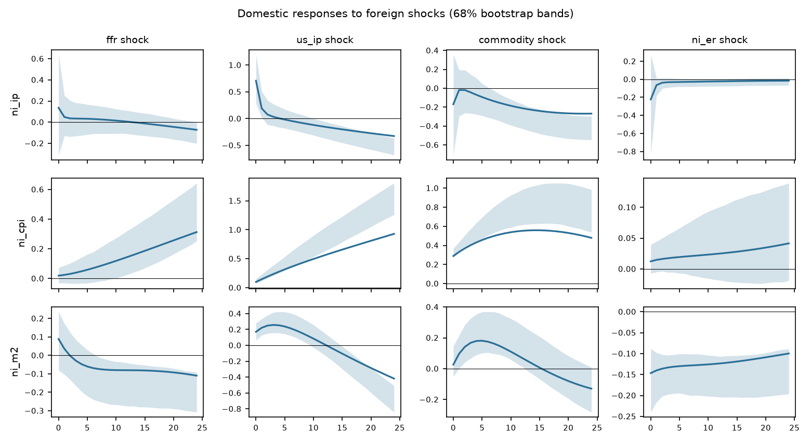

# Block-exogenous SVAR

Foreign block {ffr, us_ip, commodity, ni_er}, domestic block {ni_ip, ni_cpi, ni_m2}. Sample 2002-03 to 2014-06 (148 observations), p = 1, recursive identification in the order listed, 1000 bootstrap draws, 68% hall bands.

| Test | Statistic | df | p |
|---|---|---|---|
| block exogeneity LR (Sims) | 123.36 | 12 | <0.001 |
| lag-augmented Wald (p=1, d_max=2) | 11.84 | 12 | 0.458 |
| portmanteau (h=12) | 1042.29 | 539 | <0.001 |
| max companion root | 1.011 |  |  |

**Warning:** the block-exogeneity restriction is rejected at 5% (LR p = <0.001, lag-augmented Wald p = 0.458). It is still imposed. With integrated data the levels LR test over-rejects; the lag-augmented Wald is the valid test (see the exogeneity screen).

## Forecast error variance decomposition

**ni_ip**

| h | ffr | us_ip | commodity | ni_er | ni_ip | ni_cpi | ni_m2 |
|---|---|---|---|---|---|---|---|
| 0 | 0.1 | 1.5 | 0.1 | 0.2 | 98.2 | 0.0 | 0.0 |
| 6 | 0.1 | 1.6 | 0.2 | 0.2 | 97.4 | 0.6 | 0.0 |
| 12 | 0.1 | 1.8 | 0.7 | 0.2 | 96.0 | 1.2 | 0.0 |
| 24 | 0.1 | 3.8 | 2.8 | 0.2 | 90.6 | 2.5 | 0.1 |

**ni_cpi**

| h | ffr | us_ip | commodity | ni_er | ni_ip | ni_cpi | ni_m2 |
|---|---|---|---|---|---|---|---|
| 0 | 0.1 | 3.5 | 29.4 | 0.1 | 0.0 | 66.9 | 0.0 |
| 6 | 0.5 | 14.5 | 38.2 | 0.1 | 0.3 | 46.0 | 0.6 |
| 12 | 1.3 | 24.5 | 37.9 | 0.1 | 0.2 | 35.3 | 0.8 |
| 24 | 3.6 | 40.9 | 28.5 | 0.1 | 0.2 | 25.9 | 0.8 |

**ni_m2**

| h | ffr | us_ip | commodity | ni_er | ni_ip | ni_cpi | ni_m2 |
|---|---|---|---|---|---|---|---|
| 0 | 0.5 | 1.7 | 0.0 | 1.3 | 0.0 | 0.3 | 96.2 |
| 6 | 0.4 | 7.7 | 3.2 | 2.6 | 0.1 | 3.2 | 82.9 |
| 12 | 1.0 | 7.8 | 4.2 | 3.8 | 0.1 | 10.8 | 72.3 |
| 24 | 1.9 | 15.0 | 3.7 | 4.4 | 0.2 | 24.0 | 50.9 |

Share of domestic forecast error variance due to foreign shocks at the last horizon: ni_ip 6.9%, ni_cpi 73.1%, ni_m2 24.9%.
