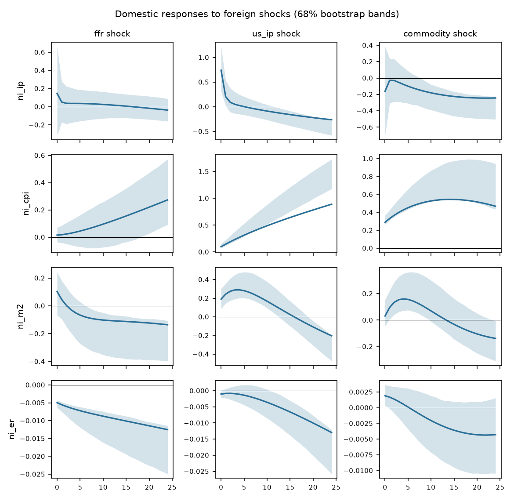

# Block-exogenous SVAR

Foreign block {ffr, us_ip, commodity}, domestic block {ni_ip, ni_cpi, ni_m2, ni_er}. Sample 2002-03 to 2014-06 (148 observations), p = 1, recursive identification in the order listed, 1000 bootstrap draws, 68% hall bands.

| Test | Statistic | df | p |
|---|---|---|---|
| block exogeneity LR (Sims) | 131.07 | 12 | <0.001 |
| lag-augmented Wald (p=1, d_max=2) | 14.79 | 12 | 0.253 |
| portmanteau (h=12) | 1085.21 | 539 | <0.001 |
| max companion root | 1.007 |  |  |

**Warning:** the block-exogeneity restriction is rejected at 5% (LR p = <0.001, lag-augmented Wald p = 0.253). It is still imposed. With integrated data the levels LR test over-rejects; the lag-augmented Wald is the valid test (see the exogeneity screen).

## Forecast error variance decomposition

**ni_ip**

| h | ffr | us_ip | commodity | ni_ip | ni_cpi | ni_m2 | ni_er |
|---|---|---|---|---|---|---|---|
| 0 | 0.1 | 1.7 | 0.1 | 98.2 | 0.0 | 0.0 | 0.0 |
| 6 | 0.1 | 1.7 | 0.2 | 97.5 | 0.5 | 0.0 | 0.0 |
| 12 | 0.1 | 1.8 | 0.7 | 96.3 | 1.0 | 0.0 | 0.0 |
| 24 | 0.1 | 3.1 | 2.5 | 92.2 | 1.9 | 0.1 | 0.0 |

**ni_cpi**

| h | ffr | us_ip | commodity | ni_ip | ni_cpi | ni_m2 | ni_er |
|---|---|---|---|---|---|---|---|
| 0 | 0.1 | 3.4 | 29.3 | 0.0 | 67.1 | 0.0 | 0.0 |
| 6 | 0.3 | 14.4 | 38.2 | 0.3 | 46.2 | 0.6 | 0.0 |
| 12 | 0.8 | 24.6 | 37.9 | 0.2 | 35.6 | 0.9 | 0.0 |
| 24 | 2.8 | 41.0 | 29.0 | 0.2 | 26.0 | 1.0 | 0.0 |

**ni_m2**

| h | ffr | us_ip | commodity | ni_ip | ni_cpi | ni_m2 | ni_er |
|---|---|---|---|---|---|---|---|
| 0 | 0.6 | 2.1 | 0.1 | 0.1 | 0.3 | 96.9 | 0.0 |
| 6 | 0.5 | 9.7 | 2.5 | 0.1 | 2.4 | 84.4 | 0.4 |
| 12 | 1.4 | 11.7 | 2.9 | 0.2 | 7.6 | 75.4 | 0.9 |
| 24 | 3.6 | 11.5 | 3.7 | 0.2 | 17.4 | 62.4 | 1.3 |

**ni_er**

| h | ffr | us_ip | commodity | ni_ip | ni_cpi | ni_m2 | ni_er |
|---|---|---|---|---|---|---|---|
| 0 | 6.9 | 0.3 | 1.0 | 0.1 | 0.1 | 1.2 | 90.4 |
| 6 | 13.5 | 0.4 | 0.5 | 0.1 | 1.8 | 3.8 | 79.8 |
| 12 | 19.8 | 2.2 | 0.9 | 0.0 | 6.1 | 4.0 | 67.0 |
| 24 | 27.3 | 14.0 | 2.8 | 0.1 | 14.7 | 2.2 | 39.1 |

Share of domestic forecast error variance due to foreign shocks at the last horizon: ni_ip 5.8%, ni_cpi 72.8%, ni_m2 18.7%, ni_er 44.0%.
