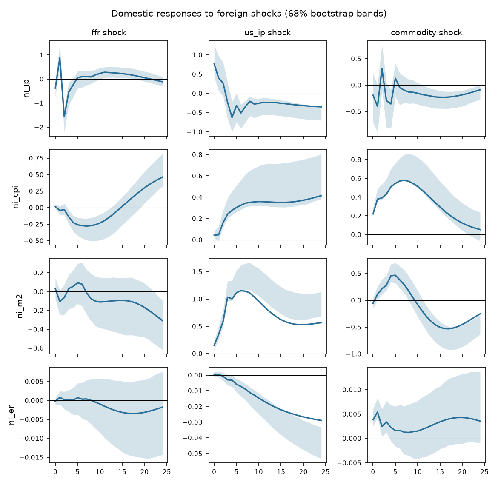

# Block-exogenous SVAR

Foreign block {ffr, us_ip, commodity}, domestic block {ni_ip, ni_cpi, ni_m2, ni_er}. Sample 2002-06 to 2014-06 (145 observations), p = 4, recursive identification in the order listed, 1000 bootstrap draws, 68% hall bands.

| Test | Statistic | df | p |
|---|---|---|---|
| block exogeneity LR (Sims) | 85.98 | 48 | <0.001 |
| lag-augmented Wald (p=4, d_max=2) | 64.15 | 48 | 0.059 |
| portmanteau (h=12) | 587.72 | 392 | <0.001 |
| max companion root | 0.986 |  |  |

**Warning:** the block-exogeneity restriction is rejected at 5% (LR p = <0.001, lag-augmented Wald p = 0.059). It is still imposed. With integrated data the levels LR test over-rejects; the lag-augmented Wald is the valid test (see the exogeneity screen).

## Forecast error variance decomposition

**ni_ip**

| h | ffr | us_ip | commodity | ni_ip | ni_cpi | ni_m2 | ni_er |
|---|---|---|---|---|---|---|---|
| 0 | 0.6 | 2.3 | 0.1 | 97.0 | 0.0 | 0.0 | 0.0 |
| 6 | 11.1 | 4.8 | 1.6 | 78.0 | 0.9 | 1.5 | 2.2 |
| 12 | 11.4 | 5.8 | 1.9 | 75.2 | 1.9 | 1.7 | 2.1 |
| 24 | 11.5 | 8.3 | 3.0 | 70.7 | 2.8 | 1.7 | 2.0 |

**ni_cpi**

| h | ffr | us_ip | commodity | ni_ip | ni_cpi | ni_m2 | ni_er |
|---|---|---|---|---|---|---|---|
| 0 | 0.1 | 1.0 | 26.1 | 0.1 | 72.7 | 0.0 | 0.0 |
| 6 | 7.2 | 12.2 | 47.8 | 0.2 | 32.3 | 0.1 | 0.2 |
| 12 | 8.7 | 17.6 | 48.3 | 0.1 | 24.9 | 0.2 | 0.2 |
| 24 | 14.0 | 26.8 | 34.9 | 0.1 | 23.8 | 0.4 | 0.2 |

**ni_m2**

| h | ffr | us_ip | commodity | ni_ip | ni_cpi | ni_m2 | ni_er |
|---|---|---|---|---|---|---|---|
| 0 | 0.1 | 1.8 | 0.2 | 0.5 | 0.8 | 96.6 | 0.0 |
| 6 | 0.4 | 58.8 | 8.1 | 0.6 | 1.1 | 30.4 | 0.5 |
| 12 | 0.6 | 73.0 | 6.4 | 0.4 | 1.4 | 17.7 | 0.5 |
| 24 | 2.1 | 68.0 | 14.8 | 0.3 | 2.4 | 12.1 | 0.4 |

**ni_er**

| h | ffr | us_ip | commodity | ni_ip | ni_cpi | ni_m2 | ni_er |
|---|---|---|---|---|---|---|---|
| 0 | 0.0 | 0.2 | 5.9 | 0.0 | 0.0 | 0.1 | 93.7 |
| 6 | 0.1 | 4.2 | 2.7 | 0.1 | 0.6 | 0.4 | 91.9 |
| 12 | 0.1 | 21.0 | 1.4 | 0.0 | 3.9 | 0.5 | 72.9 |
| 24 | 0.7 | 52.9 | 1.5 | 0.0 | 11.5 | 0.4 | 33.0 |

Share of domestic forecast error variance due to foreign shocks at the last horizon: ni_ip 22.8%, ni_cpi 75.7%, ni_m2 84.9%, ni_er 55.1%.
