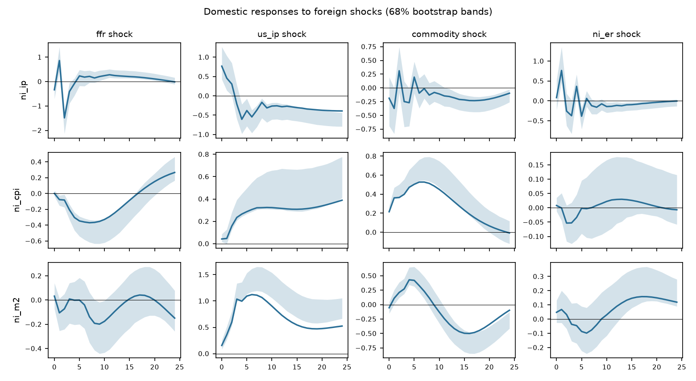

# Which variables are exogenous to Nicaragua? A theory-plus-data screen before the SVAR

Prepared 2026-10-14 with `csuf-fullerton` (change 0004). Every number below is produced by the
commands in section 8 from `data/nicaragua.csv`; the full machine output is in `outputs/`.

## 1. Answer first

- **Recommended split.** Foreign block {federal funds rate, U.S. industrial production, world
  commodity prices, córdoba/dollar rate}; domestic block {Nicaraguan industrial production,
  CPI, broad money}. It is the top-ranked specification at lag order 1 (BIC), at lag order 4
  (AIC), and with lag augmentation 1 or 2.
- **What the data say about it.** Domestic variables do not Granger-cause the foreign block at
  any lag: bootstrap lag-augmented Wald p = **0.55** (p = 1) and **0.41** (p = 4). None of the 15
  admissible splits is rejected by this test after Holm adjustment.
- **The one statistical objection.** U.S. industrial production fails the weak-exogeneity test
  (it loads on cointegrating relations that involve Nicaraguan variables). That is why the
  verdict is "mixed" rather than "supported". Theory says this loading cannot be structural;
  section 6 lists the likely reasons and what would settle it.
- **What changed versus the thesis split.** Moving the exchange rate into the foreign block
  improves BIC (-2.788 against -2.727 at p = 1; -1.559 against -1.422 at p = 4) and is
  consistent with the crawling peg: the rate followed a pre-announced 5% a year path, so it is
  predetermined with respect to monthly domestic shocks.
- **Headline responses that do not depend on the split.** At p = 4, every one of the 14
  surviving specifications and orderings agrees on the sign of the peak response of
  Nicaraguan output and prices to a U.S. rate shock (both fall), of output to U.S. activity
  (rises), and of prices to commodity prices (rise).

## 2. The problem this solves

Change 0002 imposes the block-exogeneity restriction the researcher types and tests that one
split. That leaves three gaps a committee will ask about:

1. The split is asserted. Nothing shows the alternatives were considered and are worse.
2. The standard test is invalid for these data. Macro series in levels are integrated, and the
   Wald and LR tests of zero lag coefficients then over-reject. A Monte Carlo on this package
   (5 variables, 150 observations, true restriction, p = 2) rejects at **37%** (Wald) and
   **34%** (LR) at a nominal 5%. The lag-augmented test rejects at **10.7%** asymptotically and
   **6%** with the bootstrap used here.
3. Lagged and contemporaneous exogeneity are different claims. Granger tests only cover lags.
   The zero in the impact matrix is an identifying assumption that second moments cannot test.

## 3. What "exogenous" means, and which parts are testable

Engle, Hendry and Richard (1983) separate the claims. The SVAR makes three about the foreign
block:

| Claim | Restriction | Test used | Testable? |
|---|---|---|---|
| Lagged exogeneity (Granger non-causality) | domestic lags excluded from foreign equations | Toda and Yamamoto (1995) lag-augmented Wald, bootstrap p (Hacker and Hatemi-J 2006), Holm across candidates | Yes |
| Long-run (weak) exogeneity | foreign variables do not adjust to domestic disequilibria | F-test of error-correction loadings, GVAR style (Pesaran, Schuermann and Weiner 2004) | Yes, when cointegrated |
| Contemporaneous exogeneity | foreign variables do not react within the month to domestic shocks | none from second moments; DirectLiNGAM ordering from non-Gaussian residuals (Shimizu et al. 2011; Hyvärinen and Smith 2013) | Partly, advisory |

## 4. Method

1. **Theory file** (`examples/nicaragua/theory.toml`). Each variable gets a prior with a written
   reason and a citation. The federal funds rate, U.S. output and commodity prices are
   `exogenous` (small open economy, Cushman and Zha 1997; Maćkowiak 2007). The exchange rate is
   a `candidate` (crawling peg). Output, CPI and money are `endogenous`.
2. **Candidates.** Every subset of the four foreign-eligible variables: 15 splits. Grade A puts
   all three exogenous-by-theory variables in the foreign block; grade B leaves at least one of
   them domestic; an endogenous variable in the foreign block is inadmissible.
3. **Integration and lags.** ADF and KPSS per series, Johansen trace rank with the Reinsel and
   Ahn (1992) small-sample correction, lag order by AIC, BIC and HQ.
4. **Battery per candidate.** Bootstrap lag-augmented Wald (primary verdict), Sims-corrected LR
   (reported, invalid under unit roots), instantaneous causality, weak exogeneity, Clark-West
   out-of-sample test, BIC, residual portmanteau, stability, agreement with the data-driven
   causal ordering.
5. **Ranking.** Theory grade first, then verdict, then BIC. The screen recommends; the
   researcher chooses the split passed to `svar`. That separation avoids treating a pretest
   winner as if it were known in advance (Leeb and Pötscher 2005).
6. **Robustness.** Headline impulse responses across every surviving split and three
   alternative orderings of the domestic block.

## 5. Data

Monthly, 2001-12 to 2014-06, 151 complete months (148 after lags). U.S. series from FRED; FRED
has only annual Nicaraguan data, so Nicaraguan series come from the IMF SDMX API.

| Column | Series | Source | Transform |
|---|---|---|---|
| `ffr` | Effective federal funds rate | FRED `FEDFUNDS` | level, percent |
| `us_ip` | U.S. industrial production | FRED `INDPRO` | 100 x log |
| `commodity` | IMF all-commodities price index | FRED `PALLFNFINDEXM` | 100 x log |
| `ni_er` | Córdobas per dollar, period average | IMF `ER` | 100 x log |
| `ni_ip` | Industrial production, NSA | IMF `PI` | 100 x log |
| `ni_cpi` | CPI, all items, spliced | IMF `CPI` | 100 x log |
| `ni_m2` | Broad money, SA | IMF `MFS_DC` | 100 x log |

The sample is bounded by broad money (starts 2001-12) and industrial production (IMF series
ends 2014-06). Constant, linear trend and centred monthly dummies enter every equation.

## 6. Results

### Integration and cointegration

Output, CPI, money, U.S. output and commodity prices are I(1). The federal funds rate and the
exchange rate are flagged as conflicts: the funds rate sits at the zero lower bound for 44% of
the sample, and the exchange rate is close to a deterministic trend under the crawl. The rule
takes `d_max = 2`; rerunning with `d_max = 1` changes no ranking. Johansen finds rank 4 of 7.

### Pairwise Granger evidence

No pairwise Granger relation survives Holm adjustment across the 42 pairs. The smallest
unadjusted p-values run in the direction theory expects: commodity prices to Nicaraguan CPI
(0.005), commodity prices to U.S. output (0.008), the funds rate to Nicaraguan CPI (0.012) and
to Nicaraguan output (0.014). One unadjusted p-value runs the other way, broad money to U.S.
output (0.048); with 42 tests about two such values are expected by chance, and it does not
survive adjustment. See `outputs/screen/granger.png`.

### Candidate table (p = 1, top six of 15)

| Rank | Foreign block | Theory | Verdict | Boot p | LR p | Not weakly exog. | BIC |
|---|---|---|---|---|---|---|---|
| 1 | ffr, us_ip, commodity, ni_er | A | mixed | 0.547 | <0.001 | us_ip | -2.788 |
| 2 | ffr, us_ip, commodity (thesis) | A | mixed | 0.325 | <0.001 | ffr, us_ip | -2.727 |
| 3 | commodity | B | supported | 0.632 | 0.023 | none | -3.637 |
| 4 | commodity, ni_er | B | supported | 0.838 | 0.008 | none | -3.566 |
| 5 | ffr | B | supported | 0.312 | <0.001 | none | -3.249 |
| 6 | ffr, commodity | B | supported | 0.347 | <0.001 | none | -3.231 |

Two readings matter. First, the LR test of change 0002 rejects nearly every split while the
valid lag-augmented test rejects none; that gap is the unit-root distortion in section 2, not
evidence against the small-open-economy structure. Second, grade-B splits score better on BIC
because they impose fewer zeros on a levels likelihood that over-rewards fit under unit roots;
they rank below grade A because they let the Nicaraguan economy move U.S. variables.

### Weak exogeneity of U.S. output

U.S. industrial production loads on the cointegrating relations that involve Nicaraguan
variables (p < 0.001). Theory rules out a structural channel. Three explanations fit the
evidence, in order of plausibility:

1. **Common shock.** The 2008-09 collapse hit U.S. output and Nicaraguan maquila output
   together, so error-correction terms built from both co-move with U.S. output.
2. **Over-estimated rank.** Johansen with 7 variables and 151 months over-states rank even after
   the Reinsel-Ahn correction; extra spurious relations give U.S. output something to load on.
3. **Zero lower bound.** With the funds rate fixed for 44% of the sample, U.S. activity carries
   the monetary signal, which can surface as adjustment.

A sample-split or a break dummy for 2008-09 is the cheapest test of the first explanation.

### Contemporaneous ordering

DirectLiNGAM orders the residuals ni_er, commodity, ni_ip, ni_m2, us_ip, ni_cpi, ffr. It puts
the exchange rate and commodity prices first, which supports their place in the foreign block,
but puts the funds rate last. At the zero lower bound the funds-rate residual is nearly
constant, so this ordering cannot speak to the funds rate. The bootstrap 5th percentile of
agreement is low (0.25 for the recommended split): the data are only weakly informative about
contemporaneous direction, which is why this evidence does not enter the verdict.

### Impulse responses, recommended split, p = 4

At p = 1 the residuals are strongly autocorrelated (portmanteau statistic 1042 on 539 df), so
the structural analysis uses p = 4. One-standard-deviation shocks: funds rate 0.10 points, U.S.
output 0.57%, commodity prices 3.3%, exchange rate 0.016%.

| Response to | Nicaraguan output | Nicaraguan CPI | Broad money |
|---|---|---|---|
| Funds rate +0.10 pt | -1.49% at month 2 | -0.37% at month 7 | -0.20% at month 9 |
| U.S. output +0.57% | +0.77% on impact | +0.39% at month 24 | +1.12% at month 6 |
| Commodity prices +3.3% | -0.37% at month 1 | +0.53% at month 7 | -0.50% at month 16 |



Foreign shocks explain **26%** of the 24-month forecast error variance of Nicaraguan output,
**73%** of CPI and **84%** of broad money. The thesis split gives 23%, 76% and 85%: the
choice between the two grade-A splits does not move the variance decomposition much.

Robustness at p = 4: 14 of 14 surviving specifications and orderings share the sign of the
peak response for all four headline pairs. At p = 1 the output response to a funds-rate shock
is not robust (6 of 15), another sign that p = 1 is too short.


## 7. Caveats

- **Bands.** The bootstrap is centred below the point estimate for persistent responses, the
  small-sample bias Kilian (1998) corrects. Hall intervals are reported; Kilian's bias-corrected
  bootstrap is the next estimator change.
- **Zero lower bound.** The funds rate is close to zero from 2008-12. A shadow rate (Wu and Xia
  2016) is the standard fix and would need a non-FRED source.
- **Seasonality.** Output and CPI are not seasonally adjusted; monthly dummies remove the
  deterministic part only, and the zigzag in the output responses is residual seasonality.
- **Residual autocorrelation** remains at p = 4 (portmanteau p < 0.001).
- **Sample.** 148 usable months for 7 variables. Pre-zero-lower-bound subsamples are too short.

## 8. Reproduce

```
csuf-fullerton init                     # optional, stores a FRED key; keyless CSV also works
csuf-fullerton fetch examples/nicaragua/data.toml --out data/nicaragua.csv
csuf-fullerton screen data/nicaragua.csv examples/nicaragua/theory.toml --max-lags 4 --out results/screen
csuf-fullerton screen data/nicaragua.csv examples/nicaragua/theory.toml --lags 4 --out results/screen_p4
csuf-fullerton svar data/nicaragua.csv --foreign ffr,us_ip,commodity,ni_er \
  --domestic ni_ip,ni_cpi,ni_m2 --lags 4 --seasonal --dmax 2 --draws 1000 --bands hall \
  --out results/svar_recommended_p4
```

## References

- Cushman, D. O. and Zha, T. (1997), *Journal of Monetary Economics* 39(3): 433-448.
- Engle, R. F., Hendry, D. F. and Richard, J.-F. (1983), "Exogeneity," *Econometrica* 51(2): 277-304.
- Hacker, R. S. and Hatemi-J, A. (2006), "Tests for causality between integrated variables
  using asymptotic and bootstrap distributions," *Applied Economics* 38(13): 1489-1500.
- Hyvärinen, A. and Smith, S. M. (2013), *Journal of Machine Learning Research* 14: 111-152.
- Kilian, L. (1998), "Small-sample confidence intervals for impulse response functions,"
  *Review of Economics and Statistics* 80(2): 218-230.
- Leeb, H. and Pötscher, B. M. (2005), *Econometric Theory* 21(1): 21-59.
- Maćkowiak, B. (2007), *Journal of Monetary Economics* 54(8): 2512-2520.
- Pesaran, M. H., Schuermann, T. and Weiner, S. M. (2004), *JBES* 22(2): 129-162.
- Reinsel, G. C. and Ahn, S. K. (1992), "Vector autoregressive models with unit roots and
  reduced rank structure," *Journal of Time Series Analysis* 13(4): 353-375.
- Shimizu, S. et al. (2011), "DirectLiNGAM," *Journal of Machine Learning Research* 12: 1225-1248.
- Toda, H. Y. and Yamamoto, T. (1995), *Journal of Econometrics* 66: 225-250.
- Wu, J. C. and Xia, F. D. (2016), "Measuring the macroeconomic impact of monetary policy at
  the zero lower bound," *Journal of Money, Credit and Banking* 48(2-3): 253-291.
